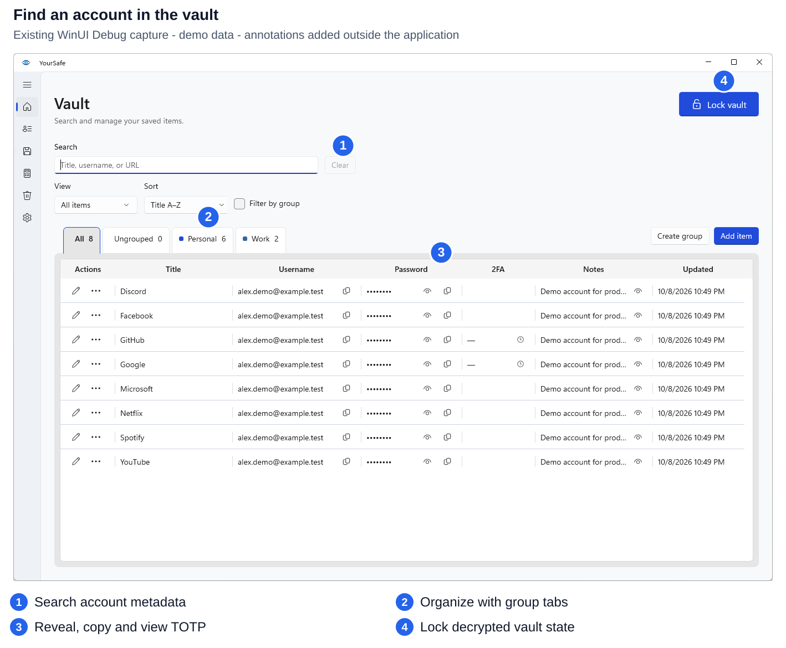
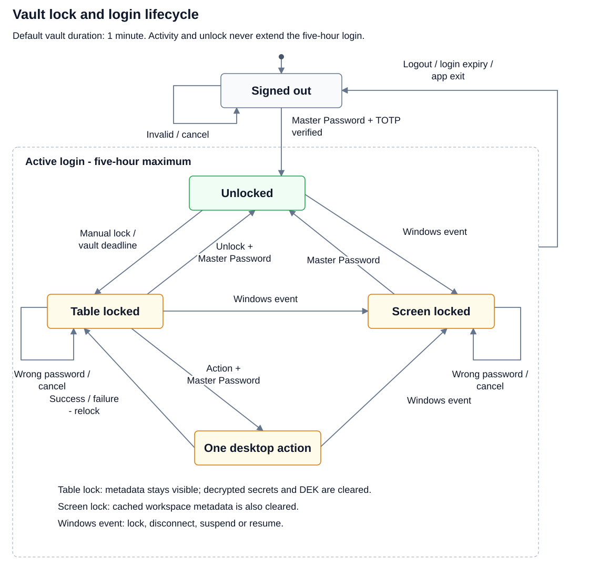
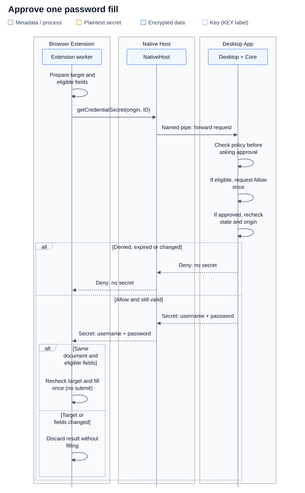

# YourSafe

YourSafe is a local Windows password manager for passwords, website verification codes (TOTP), and account recovery codes. It includes an encrypted vault, password and passphrase generation, a local security check, and optional Chrome, Edge, and Brave integration.

Vault data stays on your device. The desktop app uses WinUI 3 and works without an online account, cloud service, telemetry, or an internet connection. Encrypted backups and updates are managed manually.



Existing WinUI Debug capture with synthetic demo accounts. [Open full size](docs/diagrams/vault-overview.svg) · [Diagram collection and editable sources](docs/diagrams/README.md).

## What is included

| Feature | What you can do |
| --- | --- |
| **Encrypted vault** | Store passwords, website TOTP, recovery codes, usernames, URLs, and notes in an AES-256-GCM encrypted local file. |
| **Organization** | Search locally, mark favorites, and organize entries with groups and tags. Groups appear as configurable tabs. |
| **Password generation** | Generate cryptographically random passwords and readable passphrases with strength feedback. |
| **Browser integration** | Fill a selected account or view/copy its website TOTP after a separate approval on the unlocked desktop. |
| **Local Security Check** | Find weak, exactly reused, or old passwords without sending them to an online service. |
| **Password history and Trash** | Keep up to 10 previous passwords per entry and restore deleted items from a 30-day Trash. |
| **Recovery Key** | Reset the current vault's Master Password and sign-in Authenticator when either is lost. |
| **Backup and import** | Create and verify encrypted external backups, recover on a new Windows installation, and preview CSV imports. |

A separate **Hash Tool** generates, verifies, and inspects password hashes. Its optional HTTP API is for local development and is independent of the vault and browser integration.

## Download and install

Download a Windows x64 package from [GitHub Releases](https://github.com/Lmnhutw/PasswordTool.Core/releases) and read its release notes and `release-status.txt` before running it.

- **Installer (`YourSafe-setup.exe`):** installs for the current Windows user and adds a YourSafe Start Menu shortcut without requiring administrator access.
- **Portable ZIP:** extract the complete archive to a folder you control, then run `YourSafe.exe`. Keep the executable and its adjacent files together.

The automated tag workflow currently produces `UNSIGNED` builds for developer/test evaluation. Windows may show an unknown-publisher warning. Signed distribution requires separately configured signing; do not assume a release is signed because it has a version tag.

Compare the downloaded package's SHA-256 value with its entry in `checksums.sha256`:

```powershell
Get-FileHash .\YourSafe-<version>-win-x64.zip -Algorithm SHA256
```

If a release is marked `SIGNED`, also verify the executable's signature through **Properties → Digital Signatures**, or use `signtool verify /pa /tw <file>` with the Windows SDK tools.

Release builds are self-contained: you do not need to install .NET or the Windows App SDK runtime separately. New versions are installed manually; YourSafe has no auto-updater.

### Upgrade, uninstall, and portable use

- Installer upgrades keep the existing vault. Uninstall removes application binaries and keeps vault data.
- The portable package still stores its vault in the current Windows profile; carrying the application folder to another PC does not carry the vault with it.
- To move data to another Windows installation, use an encrypted external backup. Do not copy only `.config` or only `.storage`.
- Delete the local vault directory only when you intend to erase it and have a usable backup if needed.

## First-time setup

1. Open YourSafe and choose **Create a new vault**. To restore an existing encrypted backup on a fresh installation, choose **Recover from encrypted backup** instead.
2. Create a strong, unique Master Password of at least 12 characters.
3. Scan the setup QR code with Google Authenticator or another compatible TOTP app, then enter the current six-digit code.
4. Save the displayed Recovery Key outside this device and confirm that you saved it. Setup does not commit before this confirmation. The key can reset both the Master Password and sign-in Authenticator, so protect it separately.
5. Add a test item, lock and unlock the vault, then create and verify an encrypted external backup before relying on it for important data.

The **vault sign-in Authenticator** protects access to YourSafe. **Website TOTP** belongs to individual saved accounts. They are separate secrets and are configured separately.

## Everyday use

### Save a credential

Choose **Add item**, enter a title and username, then enter a website URL or select **No URL**. Add a password, website TOTP, at least two valid unique recovery codes, or a combination, then select **Save item**. Assign a group, tags, and a favorite marker as needed.

Password and TOTP edits stay in the editor draft until you save; Cancel discards them. Core validates the entry, encrypts the vault payload, and saves the config/storage pair through a staged transaction. A failed write rolls back the change instead of leaving a partially saved vault.



Only a validated draft reaches encryption and storage. The vault pair includes encrypted `.storage` and `.config` metadata with wrapped keys. [Full size](docs/diagrams/save-credential.svg) · [Mermaid source](docs/diagrams/save-credential.mmd) · [Annotated editor](docs/diagrams/editor-overview.svg).

### Find, reveal, or copy

Search for the account and use its explicit reveal or copy action. The app checks the current session before returning a secret; list rows do not hold password values or TOTP secrets.

While the vault is unlocked, ordinary actions do not request another Authenticator code. If the table is locked during an active login, a desktop action can request the Master Password, open the vault for that action, and immediately relock it. **Unlock vault** instead opens it for the configured duration.

Sensitive copies use best-effort clipboard cleanup after 30 seconds and on lock, while YourSafe still owns the copied value. A value you replace is preserved. Cleanup cannot retract an earlier paste or a copy already read by another application.



Temporary access always relocks, including on failure. [Full size](docs/diagrams/reveal-copy.svg) · [Mermaid source](docs/diagrams/reveal-copy.mmd).

### Use website verification codes

Add or edit TOTP in a credential's editor and save the item. View current codes through the vault's **2FA** action, Details, or the browser popup. Website TOTP supports SHA1/SHA256/SHA512, six or eight digits, and custom periods.

Live desktop code panels require an unlocked vault and stop on closure or lock. Copy generates the current code again. Browser **View code** and **Copy code** each require their own desktop approval; a countdown does not automatically fetch another code.

### Review and organize

- Use favorites, groups, tags, and local search. Right-click a group tab to rename it or change its color; Settings offers horizontal/vertical tabs and System/Light/Dark themes.
- Run **Local Security Check** for weak passwords, exact reuse, and passwords at least 365 days old. Open the affected item through the protected editor and rescan after changes.
- Changing a password retains its latest 10 previous values inside the encrypted vault. Deleted items stay in Trash for 30 days unless restored or permanently deleted.
- CSV import previews new and duplicate accounts and adds only new accounts. CSV exports contain plaintext secrets; protect them and remove them when no longer needed.

### Sign-in and locking

| State or action | Behavior |
| --- | --- |
| **Sign in** | Requires the Master Password and a current six-digit Authenticator code. Starts a fixed five-hour login. |
| **Unlock again** | Requires only the Master Password while that login remains valid. Unlocking never extends the login. |
| **Vault duration** | Locks after a fixed duration from unlock, one minute by default. Activity does not extend it. Choices are 1, 2, 5, 10, 30, 60, 120, or 300 minutes, capped by login expiry. |
| **Manual/table lock** | Clears decrypted vault contents and the vault key. Cached list metadata, including visible account details, can remain in the workspace. |
| **Windows lifecycle lock** | Windows lock/disconnect, suspend, or resume locks the vault, clears cached workspace metadata, and cancels pending authentication and secret actions. |
| **Login expiry or app restart** | Requires a new sign-in with the Master Password and a current Authenticator code. |

Changing the vault duration requires the current Master Password. The new duration takes effect after closing and reopening the app. There is no Authenticator-only sign-in or never-lock setting.



For an enrolled vault: login and vault-open deadlines are separate. Windows lifecycle lock clears cached metadata; table lock keeps it. [Full size](docs/diagrams/vault-lifecycle.svg) · [Mermaid source](docs/diagrams/vault-lifecycle.mmd).

## Browser autofill

Browser integration is optional and starts disabled each app session. YourSafe must already be running and its vault explicitly unlocked; the extension does not ask for your Master Password or unlock the desktop.

1. Save an account with its complete website URL in the desktop app, then enable browser integration in **Settings**.
2. Open the matching website and the YourSafe browser popup. Discovery returns matching account titles, usernames, and password/TOTP capability flags without another desktop prompt.
3. Choose an account and **Fill**, **View code**, or **Copy code**. Each action requests a separate one-time approval on the desktop.
4. Review the account, stored website, reported website, and requested action. After approval, Fill populates eligible fields; it never submits the form. If the vault is locked, use **Show YourSafe**, unlock on the desktop, then refresh the popup.

Matching uses the URL's origin: scheme, normalized host, and effective port. Paths do not restrict matching; a different subdomain or port is a different origin. Public HTTPS and explicitly allowed loopback HTTP are supported. Missing, invalid, and unrelated URLs are excluded.

The extension worker communicates with `YourSafe.NativeHost.exe` through browser Native Messaging using standard input/output. NativeHost relays requests to the running desktop through a Windows named pipe; Core performs vault lookups and TOTP generation. The optional hash API is not involved.

The official extension checks the current browser document and destination fields. The desktop compares the stored origin with the origin reported by the client, but cannot independently confirm that website address; its approval dialog makes this limit explicit. Integration opt-in allows metadata discovery, while secret access still needs individual approval.

The extension does not automatically capture or save new passwords. It never receives the Master Password, vault key, website TOTP seed, or account recovery codes. **Copy code** writes through the desktop clipboard service; **View code** returns only the current code and its time window.



This follows explicit account selection; denied or stale requests release no password. The reported website remains unverified to the desktop. [Full size](docs/diagrams/browser-fill.svg) · [Mermaid source](docs/diagrams/browser-fill.mmd) · [Metadata discovery sequence](docs/diagrams/README.md#browser-discovery).

See the [extension guide](browser-extension/README.md) for supported browser versions, development installation, Native Messaging registration, production integration, and verification. Browser support does not establish store approval or availability.

## Backup and recovery

### Encrypted external backups

Use **Backup & Recovery Center** to export a backup with a separate passphrase of at least 12 characters. Store it away from the PC and use the authenticated verification action to check it. The app records successful external backup and verification times and warns when no backup is recorded or the latest is older than 30 days.

Backups include entry data such as passwords, website TOTP, recovery codes, notes, tags, favorites, password history, and Trash state. They exclude the Master Password configuration, vault sign-in Authenticator, vault key, appearance settings, and group definitions such as names, colors, and order. Do not rely on a backup to preserve group organization.

On a fresh installation, choose **Recover from encrypted backup**, enter its passphrase, review the item counts, and set up a new Master Password, sign-in Authenticator, and Recovery Key. Recovery creates a new vault key and credentials. It is available only when neither `.config` nor `.storage` exists; a partial pair must be resolved without overwriting it.

Importing an encrypted backup into an existing vault validates the full backup first and previews new, duplicate, and conflicting IDs. Only new entries are added; existing entries are not overwritten.



The backup passphrase decrypts entry data; newly confirmed credentials protect a fresh vault. A Recovery Key does not decrypt backups. [Full size](docs/diagrams/backup-recovery.svg) · [Mermaid source](docs/diagrams/backup-recovery.mmd) · [Separate export, snapshot and reset flows](docs/diagrams/README.md#export-an-encrypted-backup).

### Recovery Key reset

If you lose the Master Password or sign-in Authenticator, choose **Forgot Master Password** and use the current Recovery Key. The reset requires a new Master Password, confirmation that a fresh Recovery Key was saved, and verification of a replacement Authenticator before committing. It preserves the current vault data and returns to sign-in.

Settings can rotate the Recovery Key with the current Master Password. Older snapshots retain their own credentials and security state; changing live credentials does not rewrite those copies.

### Local snapshots and lost access

Up to five paired `.config` and `.storage` snapshots can undo local changes. Restore verifies the selected pair and requires the current Master Password plus the snapshot's Master Password when different. A successful restore ends the login; sign in again with the restored credentials. Snapshots remain on the same disk and do not protect against losing the computer or disk.

| Lost access | Recovery path |
| --- | --- |
| Master Password or sign-in Authenticator | Use the current Recovery Key to replace both. |
| Computer or Windows profile | Recover an encrypted external backup on a fresh installation using its separate passphrase. |
| Backup passphrase | That backup cannot be decrypted. The live vault remains usable with its own sign-in credentials. |
| Sign-in credentials, Recovery Key, and all usable backups | There is no hosted copy or account recovery service. |

## Security model and limits

YourSafe encrypts saved vault contents with authenticated encryption. Masked text and Hidden/System file attributes are not security boundaries.

- **Vault encryption:** a random 256-bit Data Encryption Key (DEK) encrypts the vault payload and vault sign-in Authenticator secret with AES-256-GCM and separate purpose-bound contexts.
- **Master Password:** Argon2id derives a Key Encryption Key (KEK) using three passes, 64 MiB of memory, parallelism two, and a random 32-byte salt. This key wraps the DEK; the Master Password itself is not stored.
- **Recovery Key:** independently wraps the same DEK, allowing credential reset without the old Master Password or Authenticator. Keep it protected outside the device.
- **Sign-in TOTP:** authorizes the application's login session. It does not derive or wrap an encryption key and is not an independent encryption factor against someone directly attacking copied vault files.
- **Backup encryption:** a separate backup passphrase derives its own key using PBKDF2-SHA256 with 600,000 iterations and a random salt; AES-256-GCM encrypts the exported entries.

Protected reads and writes check session deadlines. Lock clears application-held keys and decrypted secret state where the runtime permits; encrypted files remain encrypted. Plaintext is necessarily present in process memory while the vault is unlocked.



The two wrappers live in `.config`; TOTP is a separate app sign-in gate. Recovery Key access follows the reset wizard and does not itself open a login session. [Full size](docs/diagrams/vault-keys.svg) · [Mermaid source](docs/diagrams/vault-keys.mmd).

| Protection | Limit |
| --- | --- |
| Authenticated encryption protects saved vault contents. | Malware, screen capture, memory inspection, or a compromised unlocked Windows account can expose secrets. |
| Master Password plus TOTP gates normal application sign-in. | This does not make a weak Master Password safe or protect an already-unlocked session. |
| Explicit copy actions attempt clipboard cleanup. | Other applications, clipboard history/sync, and already-pasted copies are outside that guarantee. |
| Recovery Key, external backups, and local snapshots offer different recovery paths. | There is no server copy. Local snapshots cannot recover a lost disk, and backups require their passphrase. |

Use a strong unique Master Password, protect recovery material separately, lock Windows when away, and keep verified encrypted backups outside the device. See the [architecture guide](docs/architecture.md) for storage formats and compatibility details, and the [verification record](docs/demo-security-verification.md) for tested behavior and remaining qualification.

## Local files

The vault uses the existing data directory:

```text
%LocalAppData%\PasswordTool
```

| File | Contents |
| --- | --- |
| `.config` | Master and Recovery key slots wrapping the DEK, credential revision, encrypted sign-in Authenticator secret, session settings, and backup-health timestamps. |
| `.storage` | AES-256-GCM encrypted vault payload. |
| `.snapshots` | Up to five previous paired config/vault states. |
| `appearance.json` | Theme, tab placement, and built-in tab names/colors, separate from the encrypted vault. |
| `.trusted-unlock` | Compatibility token file; current desktop sign-in does not use it. |

Do not manually edit, mix, or partially restore these files. If only `.config` or `.storage` is present, the app stops rather than overwriting partial storage. The installer uses `%LocalAppData%\Programs\YourSafe`; that application directory is separate from vault data.

## Password hashing utility and API

The desktop **Hash Tool** and optional API share the implementations in `PasswordTool.Core`. Argon2id is the default recommendation; bcrypt, PBKDF2, scrypt, and ASP.NET Core Identity formats are also supported. MD5 and fast SHA options are labeled educational-only and must not be used for production password storage. Vault passwords use reversible encryption so they can be retrieved; the Hash Tool is a separate utility.

The API exposes hash, verify, inspect, and algorithm-list endpoints for local development. It enforces loopback peer/Host checks, a 32 KiB request limit, 60 requests per minute, and at most two concurrent expensive hash/verify operations. Responses disable caching and hash generation rejects educational-only algorithms. Local callers are not authenticated; public deployment requires a separate security design. See the [API guide](src/PasswordTool.Api/README.md).

## Build from source

### Requirements

- Windows x64, Windows 10 version 1809 or later
- .NET 10 SDK
- PowerShell 7 (`pwsh`) for repository scripts
- Node.js/npm when building the optional browser extension
- Git when cloning

The solution and project paths below retain their existing technical names.

```powershell
git clone https://github.com/Lmnhutw/PasswordTool.Core.git
cd PasswordTool.Core
dotnet restore PasswordTool.slnx
dotnet run --project src\PasswordTool.WinUI\PasswordTool.WinUI.csproj --configuration Debug -p:Platform=x64
```

On first launch, follow the setup flow above. A local build does not establish release signing or distribution readiness.

### Verification

```powershell
dotnet build PasswordTool.slnx
dotnet test tests\PasswordTool.Core.Tests
dotnet test tests\PasswordTool.Presentation.Tests
```

The pipe-peer test requires Windows. These commands do not build or test the TypeScript extension; follow the [extension guide](browser-extension/README.md) for its npm checks and registration. The [test guide](tests/README.md) covers unit, browser, native UI, and release checks, including disposable test vaults. Native UI scripts must never target a user vault.

## Windows releases

Version tags trigger the Windows release workflow; ordinary branch pushes, including README changes, do not publish a new application release. The current automated workflow produces unsigned installer and portable packages, plus checksums and signing status. Signed releases require controlled signing configuration and separate qualification.

Production Chrome/Edge extension IDs are optional inputs to desktop publishing. Supplied IDs must be valid store IDs; omitted IDs skip the corresponding Native Messaging manifest and installer registration. The portable ZIP does not register browser integration automatically. The extension is built separately from the .NET solution.

See [release operations](docs/release-operations.md) for version tags, test prereleases, local publishing, signing, installer prerequisites, artifact qualification, and manual upgrade/uninstall checks.

## Repository layout

```text
src/
  PasswordTool.Core/          # cryptography, vault workflows, hash implementations
  PasswordTool.Presentation/  # platform-neutral MVVM state and orchestration
  PasswordTool.WinUI/         # YourSafe Windows interface and platform adapters
  PasswordTool.NativeHost/    # browser Native Messaging and named-pipe transport
  PasswordTool.Api/           # optional local-development hash API
tests/
  PasswordTool.Core.Tests/    # domain behavior and security rules
  PasswordTool.Presentation.Tests/ # application flows and native protocol checks
browser-extension/            # standalone TypeScript Chrome/Edge/Brave extension
docs/                         # architecture, release, and verification guides
website/                      # static Vietnamese landing page
```

For implementation boundaries and compatibility rules, read the [architecture guide](docs/architecture.md) and [Core contract](src/PasswordTool.Core/README.md).
