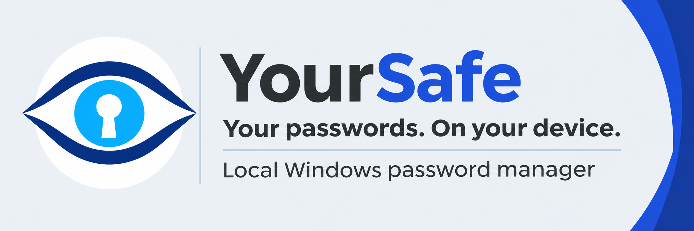

# YourSafe

[English](README.md) · **Tiếng Việt** · [Giấy phép MIT](LICENSE)

> Mật khẩu của bạn. Trên thiết bị của bạn.

YourSafe là ứng dụng quản lý mật khẩu cục bộ trên Windows, hỗ trợ mật khẩu, mã xác minh website (TOTP) và mã khôi phục tài khoản. Ứng dụng có kho dữ liệu được mã hóa, trình tạo mật khẩu và cụm mật khẩu, kiểm tra bảo mật cục bộ, cùng tính năng tích hợp tùy chọn với Chrome, Edge và Brave.

Dữ liệu kho được lưu trên thiết bị của bạn. Ứng dụng desktop sử dụng WinUI 3, hoạt động không cần tài khoản trực tuyến, dịch vụ đám mây, thu thập dữ liệu sử dụng hoặc kết nối internet. Việc sao lưu mã hóa và cập nhật được thực hiện thủ công.

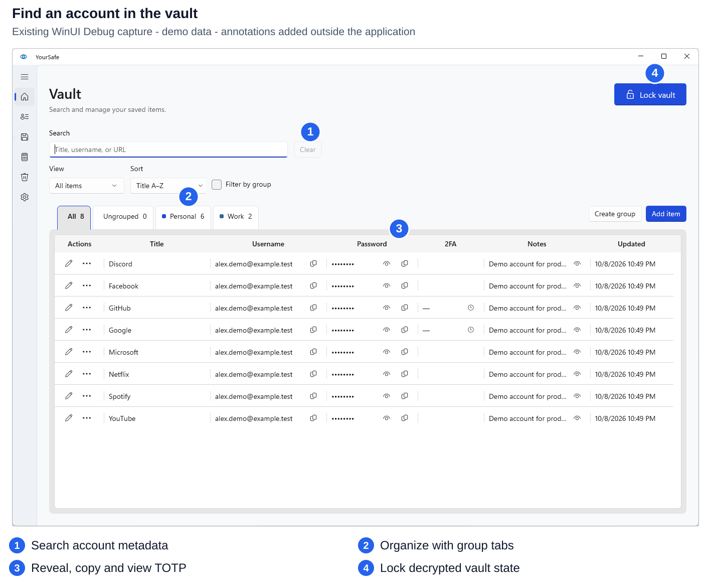

Ảnh chụp bản WinUI Debug với tài khoản demo giả lập. [Xem kích thước đầy đủ](docs/diagrams/vault-overview.svg) · [Bộ sơ đồ và mã nguồn có thể chỉnh sửa](docs/diagrams/README.md).

## Mục lục

- [Tính năng](#tính-năng)
- [Tải xuống và cài đặt](#tải-xuống-và-cài-đặt)
- [Thiết lập lần đầu](#thiết-lập-lần-đầu)
- [Sử dụng hằng ngày](#sử-dụng-hằng-ngày)
- [Tự động điền trên trình duyệt](#tự-động-điền-trên-trình-duyệt)
- [Sao lưu và khôi phục](#sao-lưu-và-khôi-phục)
- [Mô hình bảo mật và giới hạn](#mô-hình-bảo-mật-và-giới-hạn)
- [Các tệp cục bộ](#các-tệp-cục-bộ)
- [Công cụ băm mật khẩu và API](#công-cụ-băm-mật-khẩu-và-api)
- [Biên dịch từ mã nguồn](#biên-dịch-từ-mã-nguồn)
- [Phát hành cho Windows](#phát-hành-cho-windows)
- [Cấu trúc repository](#cấu-trúc-repository)
- [Giấy phép](#giấy-phép)

Tên nút và mục trong ứng dụng được giữ bằng tiếng Anh để dễ đối chiếu với giao diện. Các sơ đồ và tài liệu chuyên sâu được liên kết bên dưới hiện dùng tiếng Anh.

## Tính năng

| Tính năng | Bạn có thể làm gì |
| --- | --- |
| **Kho mã hóa** | Lưu mật khẩu, TOTP của website, mã khôi phục, tên đăng nhập, URL và ghi chú trong tệp cục bộ được mã hóa bằng AES-256-GCM. |
| **Sắp xếp dữ liệu** | Tìm kiếm cục bộ, đánh dấu yêu thích và phân nhóm các mục. All hiển thị mọi mục; mục mới mặc định thuộc All. |
| **Tạo mật khẩu** | Tạo mật khẩu ngẫu nhiên bằng bộ sinh số ngẫu nhiên mật mã và cụm mật khẩu dễ đọc, kèm đánh giá độ mạnh. |
| **Tích hợp trình duyệt** | Điền tài khoản đã chọn hoặc xem/sao chép TOTP của website sau khi phê duyệt riêng trên ứng dụng desktop đang mở khóa. |
| **Local Security Check** | Phát hiện mật khẩu yếu, trùng khớp hoàn toàn hoặc đã cũ mà không gửi chúng đến dịch vụ trực tuyến. |
| **Lịch sử mật khẩu và Thùng rác** | Giữ tối đa 10 mật khẩu trước đó cho mỗi mục và khôi phục mục đã xóa từ Thùng rác trong 30 ngày. |
| **Recovery Key** | Đặt lại Master Password và Authenticator đăng nhập của kho hiện tại khi mất một trong hai. |
| **Sao lưu và nhập dữ liệu** | Tạo, xác minh bản sao lưu mã hóa bên ngoài, khôi phục trên bản cài Windows mới và xem trước dữ liệu nhập từ CSV. |

**Hash Tool** là công cụ riêng để tạo, xác minh và kiểm tra định dạng chuỗi băm mật khẩu. HTTP API tùy chọn của công cụ phục vụ phát triển cục bộ, độc lập với kho dữ liệu và tích hợp trình duyệt.

### Tìm hiểu các luồng chính

[Hướng dẫn sơ đồ](docs/diagrams/README.md) mô tả cách triển khai từ thao tác người dùng đến kiểm tra hợp lệ, cấp quyền, lưu trữ và xử lý lỗi. Bắt đầu từ câu hỏi bạn cần giải đáp:

| Câu hỏi | Sơ đồ tham khảo |
| --- | --- |
| Những thành phần nào chạy trên PC và trình duyệt kết nối đến chúng như thế nào? | [Thành phần và đường đi dữ liệu](docs/diagrams/README.md#system-architecture) |
| Quá trình thiết lập tạo những gì và khi nào cần OTP? | [Khởi chạy lần đầu](docs/diagrams/README.md#first-launch) và [đăng nhập](docs/diagrams/README.md#sign-in) |
| Khóa kho thực sự xóa những gì khỏi bộ nhớ? | [Vòng đời đăng nhập và khóa](docs/diagrams/README.md#login-and-lock-lifecycle) |
| Dữ liệu nào được lưu và xử lý thế nào khi lưu thất bại? | [Mô hình dữ liệu kho](docs/diagrams/README.md#vault-data-model) và [lưu cặp tệp](docs/diagrams/README.md#paired-persistence) |
| Nên dùng Recovery Key, snapshot, khôi phục hay nhập dữ liệu? | [Chọn phương án khôi phục](docs/diagrams/README.md#choose-a-recovery-path) |

## Tải xuống và cài đặt

Tải gói Windows x64 từ [GitHub Releases](https://github.com/Lmnhutw/PasswordTool.Core/releases), đọc ghi chú phát hành và `release-status.txt` trước khi chạy.

- **Bộ cài (`YourSafe-setup.exe`):** cài cho người dùng Windows hiện tại và tạo lối tắt YourSafe trong Start Menu, không cần quyền quản trị viên.
- **Bản ZIP portable:** giải nén toàn bộ vào thư mục bạn kiểm soát, sau đó chạy `YourSafe.exe`. Giữ tệp thực thi và các tệp đi kèm trong cùng thư mục.

Workflow tự động theo tag hiện tạo bản `UNSIGNED` để lập trình viên dùng thử và đánh giá. Windows có thể hiển thị cảnh báo nhà phát hành không xác định. Việc phân phối bản có chữ ký cần cấu hình ký riêng; tag phiên bản không đồng nghĩa với bản phát hành đã được ký.

Đối chiếu giá trị SHA-256 của gói tải xuống với mục tương ứng trong `checksums.sha256`:

```powershell
Get-FileHash .\YourSafe-<version>-win-x64.zip -Algorithm SHA256
```

Nếu bản phát hành được đánh dấu `SIGNED`, hãy kiểm tra thêm chữ ký của tệp thực thi tại **Properties → Digital Signatures**, hoặc dùng `signtool verify /pa /tw <file>` với công cụ Windows SDK.

Các bản release đóng gói sẵn runtime: bạn không cần cài riêng .NET hoặc Windows App SDK runtime. Phiên bản mới được cài thủ công; YourSafe không có trình tự động cập nhật.

### Nâng cấp, gỡ cài đặt và dùng bản portable

- Nâng cấp bằng bộ cài giữ lại kho hiện có. Gỡ cài đặt chỉ xóa các tệp ứng dụng và giữ dữ liệu kho.
- Bản portable vẫn lưu kho trong hồ sơ người dùng Windows hiện tại; mang thư mục ứng dụng sang PC khác không mang theo kho.
- Để chuyển dữ liệu sang bản cài Windows khác, hãy dùng bản sao lưu mã hóa bên ngoài. Không chỉ sao chép riêng `.config` hoặc riêng `.storage`.
- Chỉ xóa thư mục kho cục bộ khi bạn thực sự muốn xóa dữ liệu và đã có bản sao lưu sử dụng được nếu cần.

## Thiết lập lần đầu

1. Mở YourSafe và chọn **Create a new vault**. Nếu muốn khôi phục bản sao lưu mã hóa hiện có trên bản cài mới, chọn **Recover from encrypted backup**.
2. Tạo Master Password mạnh, riêng biệt, dài ít nhất 12 ký tự.
3. Quét mã QR bằng Google Authenticator hoặc ứng dụng TOTP tương thích, sau đó nhập mã sáu chữ số hiện tại.
4. Lưu Recovery Key được hiển thị ở nơi bên ngoài thiết bị và xác nhận đã lưu. Quá trình thiết lập chỉ ghi nhận thay đổi sau bước xác nhận này. Khóa có thể đặt lại cả Master Password và Authenticator đăng nhập, vì vậy hãy bảo vệ riêng.
5. Thêm một mục thử nghiệm, khóa rồi mở khóa kho, sau đó tạo và xác minh bản sao lưu mã hóa bên ngoài trước khi dùng cho dữ liệu quan trọng.

**Authenticator đăng nhập kho** bảo vệ quyền truy cập YourSafe. **TOTP của website** thuộc từng tài khoản được lưu. Đây là hai bí mật khác nhau và được thiết lập riêng.

<details>
<summary>Xem các bước thiết lập và đăng nhập, bao gồm thao tác bị từ chối hoặc hủy</summary>



[Mã nguồn thiết lập](docs/diagrams/first-launch.mmd) · [Mã nguồn đăng nhập](docs/diagrams/sign-in.mmd) · [Giải thích chi tiết](docs/diagrams/README.md#sign-in).

</details>

## Sử dụng hằng ngày

### Lưu thông tin đăng nhập

Chọn **Add item**, nhập tiêu đề, tên đăng nhập và mật khẩu, sau đó nhập URL website hoặc chọn **No URL**. TOTP của website và mã khôi phục là tùy chọn. Phần mã khôi phục yêu cầu ít nhất hai mã khác nhau do website cung cấp, phân tách bằng dòng mới hoặc dấu phẩy. Chọn **Save item**. Bạn có thể gán nhóm hiện có và đánh dấu yêu thích; All để mục ở trạng thái chưa gán nhóm.

Thay đổi mật khẩu và TOTP chỉ nằm trong bản nháp của trình chỉnh sửa cho đến khi lưu; Cancel hủy các thay đổi đó. Trình chỉnh sửa desktop yêu cầu Title, Username và Password, cùng URL hoặc **No URL**; các mục chỉ có TOTP được nhập từ nguồn khác vẫn có thể đọc và sử dụng. Core kiểm tra mục, mã hóa nội dung kho rồi lưu cặp config/storage qua giao dịch có bước chuẩn bị. Khi ghi thất bại, ứng dụng cố khôi phục cả hai tệp và hoàn tác thay đổi trong bộ nhớ. Nhật ký giao dịch đang chờ cho phép hoàn tất cặp tệp bị gián đoạn khi khởi động; xem [lưu cặp tệp](docs/diagrams/README.md#paired-persistence) để biết giới hạn xử lý lỗi.

<details>
<summary>Xem kiểm tra dữ liệu, lịch sử mật khẩu, lưu mã hóa và các nhánh xử lý lỗi</summary>


Chỉ bản nháp hợp lệ mới được mã hóa và lưu. Cặp tệp kho gồm `.storage` được mã hóa và siêu dữ liệu `.config` chứa các khóa đã được bọc. [Kích thước đầy đủ](docs/diagrams/save-credential.svg) · [Mã nguồn Mermaid](docs/diagrams/save-credential.mmd) · [Trình chỉnh sửa có chú thích](docs/diagrams/editor-overview.svg).

</details>

### Tìm, hiện hoặc sao chép

Tìm tài khoản và dùng thao tác hiện hoặc sao chép tương ứng. Ứng dụng kiểm tra phiên hiện tại trước khi trả về bí mật; các dòng trong danh sách không chứa giá trị mật khẩu hoặc bí mật TOTP.

Khi kho đang mở khóa, thao tác thông thường không yêu cầu thêm mã Authenticator. Nếu bảng bị khóa trong một phiên đăng nhập còn hiệu lực, thao tác desktop có thể yêu cầu Master Password, mở kho cho thao tác đó rồi khóa lại ngay. **Unlock vault** mở kho trong khoảng thời gian đã cấu hình.

Ứng dụng cố gắng xóa dữ liệu nhạy cảm khỏi clipboard sau 30 giây và khi khóa, nếu giá trị sao chép vẫn thuộc YourSafe. Nếu bạn đã thay clipboard bằng giá trị khác, giá trị mới được giữ lại. Việc dọn clipboard không thu hồi được dữ liệu đã dán hoặc đã bị ứng dụng khác đọc.

<details>
<summary>Xem cấp quyền, mở khóa tạm thời và dọn clipboard</summary>


Truy cập tạm thời luôn khóa lại, kể cả khi thao tác thất bại. [Kích thước đầy đủ](docs/diagrams/reveal-copy.svg) · [Mã nguồn Mermaid](docs/diagrams/reveal-copy.mmd).

</details>

### Dùng mã xác minh website

Thêm hoặc chỉnh sửa TOTP trong trình chỉnh sửa thông tin đăng nhập rồi lưu mục. Xem mã hiện tại qua thao tác **2FA** của kho, Details hoặc popup trình duyệt. TOTP của website hỗ trợ SHA1/SHA256/SHA512, mã sáu hoặc tám chữ số và chu kỳ tùy chỉnh.

Bảng mã cập nhật trực tiếp trên desktop yêu cầu kho mở khóa và dừng khi đóng bảng hoặc khóa kho. Thao tác sao chép tạo lại mã hiện tại. **View code** và **Copy code** trên trình duyệt đều cần phê duyệt riêng trên desktop; bộ đếm ngược không tự động lấy mã mới.

Xem [các luồng TOTP của website](docs/diagrams/README.md#website-totp) để phân biệt bảng mã cập nhật trực tiếp trên desktop, mã lấy một lần qua trình duyệt và việc chuyển mã vào clipboard bằng desktop.

### Kiểm tra và sắp xếp

- Dùng mục yêu thích, nhóm và tìm kiếm cục bộ. Nhấp chuột phải vào tab nhóm để đổi tên hoặc màu; Settings có tùy chọn tab ngang/dọc và giao diện System/Light/Dark.
- Chạy **Local Security Check** để tìm mật khẩu yếu, trùng khớp hoàn toàn hoặc đã được dùng ít nhất 365 ngày. Mở mục cần xử lý bằng trình chỉnh sửa được bảo vệ và quét lại sau khi thay đổi.
- Khi đổi mật khẩu, kho mã hóa giữ tối đa 10 giá trị trước đó gần nhất. Mục bị xóa nằm trong Trash 30 ngày, trừ khi được khôi phục hoặc xóa vĩnh viễn.
- Nhập CSV cho phép xem trước tài khoản mới và trùng lặp, chỉ thêm tài khoản mới. CSV xuất ra chứa bí mật dạng văn bản thuần; hãy bảo vệ và xóa khi không còn cần.

[Sơ đồ vòng đời mật khẩu](docs/diagrams/README.md#password-lifecycle-and-trash) liên kết việc đổi mật khẩu, lịch sử, Local Security Check và Trash. [Sơ đồ nhập dữ liệu](docs/diagrams/README.md#import-into-an-existing-vault) giải thích khác biệt giữa đối chiếu ID trong bản sao lưu và đối chiếu tài khoản CSV; đối chiếu CSV bao gồm toàn bộ cấu hình TOTP.

### Đăng nhập và khóa

| Trạng thái hoặc thao tác | Hành vi |
| --- | --- |
| **Đăng nhập** | Yêu cầu Master Password và mã Authenticator sáu chữ số hiện tại. Bắt đầu phiên đăng nhập có thời hạn cố định năm giờ. |
| **Mở khóa lại** | Chỉ yêu cầu Master Password khi phiên đăng nhập còn hiệu lực. Mở khóa không gia hạn phiên đăng nhập. |
| **Thời gian mở kho** | Khóa sau khoảng thời gian cố định tính từ lúc mở khóa, mặc định một phút. Hoạt động sử dụng không gia hạn thời gian. Các lựa chọn là 1, 2, 5, 10, 30, 60, 120 hoặc 300 phút, không vượt quá thời điểm hết hạn đăng nhập. |
| **Khóa thủ công/khóa bảng** | Xóa nội dung kho đã giải mã và khóa mã hóa kho khỏi bộ nhớ. Siêu dữ liệu danh sách được lưu tạm, bao gồm thông tin tài khoản đang hiển thị, có thể vẫn còn trong không gian làm việc. |
| **Khóa theo vòng đời Windows** | Khóa/ngắt kết nối Windows, tạm ngưng hoặc tiếp tục hệ thống sẽ khóa kho, xóa siêu dữ liệu được lưu tạm của không gian làm việc và hủy xác thực cùng thao tác bí mật đang chờ. |
| **Hết hạn đăng nhập hoặc khởi động lại ứng dụng** | Yêu cầu đăng nhập mới bằng Master Password và mã Authenticator hiện tại. |

Chọn thời gian mở kho, nhấn **Save security settings** rồi nhập Master Password hiện tại một lần. Nếu hủy hoặc nhập sai mật khẩu, lựa chọn vẫn hiển thị nhưng chưa được lưu. Lưu từ phiên đang khóa bảng sẽ khóa lại ngay. Thời gian mới có hiệu lực sau khi đóng và mở lại ứng dụng. Tạo Recovery Key mới có lời nhắc mật khẩu riêng và yêu cầu kho được mở khóa rõ ràng. Không có chế độ chỉ đăng nhập bằng Authenticator hoặc không bao giờ khóa.


Với kho đã thiết lập: hạn đăng nhập và hạn mở kho là riêng biệt. Khóa theo vòng đời Windows xóa siêu dữ liệu được lưu tạm; khóa bảng giữ lại dữ liệu này. [Kích thước đầy đủ](docs/diagrams/vault-lifecycle.svg) · [Mã nguồn Mermaid](docs/diagrams/vault-lifecycle.mmd).

## Tự động điền trên trình duyệt

Tích hợp trình duyệt là tùy chọn và mặc định tắt trong mỗi phiên ứng dụng. YourSafe phải đang chạy. Giao thức v3 cho phép kiểm tra trạng thái và **Open YourSafe** khi tích hợp tắt; tìm tài khoản và truy cập bí mật yêu cầu bật tích hợp và chủ động mở khóa kho. Tiện ích không tự khởi chạy desktop, bật tích hợp hoặc mở khóa kho.

Lời nhắc tích hợp đang tắt chỉ xuất hiện ở Vault. Nút đóng ẩn lời nhắc trong phiên ứng dụng hiện tại; mở Settings hoặc trang khác chỉ tạm ẩn lời nhắc, không đánh dấu đã đóng.

1. Lưu tài khoản với URL website đầy đủ trong ứng dụng desktop, sau đó bật tích hợp trình duyệt trong **Settings**.
2. Mở website phù hợp và popup YourSafe trên trình duyệt. Bước tìm tài khoản trả về tiêu đề, tên đăng nhập và cờ cho biết có mật khẩu/TOTP, không yêu cầu thêm xác nhận trên desktop.
3. Chọn tài khoản và **Fill**, **View code** hoặc **Copy code**. Mỗi thao tác yêu cầu một lần phê duyệt riêng trên desktop.
4. Kiểm tra tài khoản, website đã lưu, website do trình duyệt báo và thao tác được yêu cầu. Sau khi được phê duyệt, Fill điền vào các trường phù hợp; không tự gửi biểu mẫu. Nếu kho bị khóa, dùng **Open YourSafe**, mở khóa trên desktop rồi làm mới popup. Khi đang chờ phê duyệt, **Open YourSafe** và **Cancel** vẫn khả dụng; mở ứng dụng không khởi động lại hoặc gia hạn yêu cầu.

Đối chiếu dùng origin của URL: giao thức, tên máy chủ đã chuẩn hóa và cổng hiệu lực. Đường dẫn không giới hạn việc đối chiếu; tên miền con hoặc cổng khác được xem là origin khác. Hỗ trợ HTTPS công khai và HTTP loopback được cho phép rõ ràng. URL bị thiếu, không hợp lệ hoặc không liên quan bị loại bỏ.

Worker của tiện ích giao tiếp với `YourSafe.NativeHost.exe` qua Native Messaging của trình duyệt bằng đầu vào/đầu ra chuẩn. NativeHost chuyển tiếp yêu cầu đến desktop đang chạy qua Windows named pipe; Core tìm dữ liệu trong kho và tạo TOTP. Yêu cầu điều khiển có hạn mức riêng 30 lần mỗi phút. API băm tùy chọn không tham gia luồng này. Desktop, NativeHost và tiện ích cần được phân phối đồng bộ cho giao thức v3; phiên bản giao thức cũ yêu cầu cập nhật cả desktop và tiện ích.

Tiện ích chính thức kiểm tra tài liệu trình duyệt hiện tại và các trường đích. Desktop so sánh origin đã lưu với origin do ứng dụng khách báo, nhưng không thể tự xác nhận địa chỉ website đó; hộp thoại phê duyệt nêu rõ giới hạn này. Bật tích hợp cho phép tìm siêu dữ liệu, còn truy cập bí mật vẫn cần phê duyệt từng lần.

Tiện ích không tự thu thập hoặc lưu mật khẩu mới. Nó không nhận Master Password, khóa mã hóa kho, bí mật gốc TOTP của website hoặc mã khôi phục tài khoản. **Copy code** ghi qua dịch vụ clipboard trên desktop; **View code** chỉ trả về mã hiện tại và khoảng thời gian hiệu lực.

<details>
<summary>Xem từng bước kiểm tra trên trình duyệt và desktop trước một lần Fill được phê duyệt</summary>


Luồng này bắt đầu sau khi người dùng chọn tài khoản cụ thể; yêu cầu bị từ chối hoặc không còn hợp lệ không được nhận mật khẩu. Desktop vẫn không thể tự xác minh website được báo. [Kích thước đầy đủ](docs/diagrams/browser-fill.svg) · [Mã nguồn Mermaid](docs/diagrams/browser-fill.mmd) · [Trình tự tìm siêu dữ liệu](docs/diagrams/README.md#browser-discovery).

</details>

Xem [hướng dẫn tiện ích](browser-extension/README.md) để biết phiên bản trình duyệt được hỗ trợ, cài đặt phát triển, đăng ký Native Messaging, tích hợp production và kiểm chứng. Việc hỗ trợ trình duyệt không đồng nghĩa với việc tiện ích đã được duyệt hoặc có mặt trên cửa hàng.

## Sao lưu và khôi phục

Đặt lại bằng Recovery Key, phục hồi snapshot cục bộ, khôi phục trên bản cài mới và nhập vào kho hiện có dùng đầu vào và có tác động khác nhau. Xem [sơ đồ chọn phương án khôi phục](docs/diagrams/README.md#choose-a-recovery-path) trước khi chọn thao tác.

### Bản sao lưu mã hóa bên ngoài

Dùng **Backup & Recovery Center** để xuất bản sao lưu với cụm mật khẩu riêng dài ít nhất 12 ký tự. Lưu bản sao lưu ngoài PC và dùng thao tác xác minh có xác thực để kiểm tra. Ứng dụng ghi nhận thời điểm sao lưu bên ngoài và xác minh thành công, đồng thời cảnh báo khi chưa ghi nhận bản sao lưu hoặc bản gần nhất đã quá 30 ngày.

Bản sao lưu chứa dữ liệu các mục như mật khẩu, TOTP của website, mã khôi phục, ghi chú, trạng thái yêu thích, lịch sử mật khẩu và trạng thái Trash. Trường Tags và cột CSV cũ bị bỏ qua. Bản sao lưu không chứa cấu hình Master Password, Authenticator đăng nhập kho, khóa mã hóa kho, thiết lập giao diện và định nghĩa nhóm như tên, màu hoặc thứ tự. Không dựa vào bản sao lưu để giữ nguyên cách phân nhóm.

Dữ liệu kho phiên bản 3 xóa nhóm tích hợp Ungrouped cũ một lần sau khi xác thực thành công. Các mục của nhóm, kể cả trong Trash, giữ nguyên nội dung và dấu thời gian, đồng thời trở thành chưa gán nhóm. Nhóm đã được đổi tên được giữ lại. Hãy dùng desktop đã cập nhật với kho đã chuyển đổi: ứng dụng cũ có thể gán lại các mục chưa có nhóm vào một nhóm.

Trên bản cài mới, chọn **Recover from encrypted backup**, nhập cụm mật khẩu của bản sao lưu, xem số lượng mục rồi thiết lập Master Password, Authenticator đăng nhập và Recovery Key mới. Khôi phục tạo khóa mã hóa kho và thông tin xác thực mới. Chỉ có thể thực hiện khi cả `.config` và `.storage` đều chưa tồn tại; nếu chỉ còn một trong hai tệp, phải xử lý tình trạng đó mà không ghi đè.

Nhập bản sao lưu mã hóa vào kho hiện có sẽ kiểm tra toàn bộ bản sao lưu trước và hiển thị trước các ID mới, trùng lặp hoặc xung đột. Chỉ mục mới được thêm; mục hiện có không bị ghi đè.

<details>
<summary>Xem kiểm tra bản sao lưu, thiết lập thông tin xác thực mới và khôi phục kho mới</summary>


Cụm mật khẩu sao lưu giải mã dữ liệu các mục; thông tin xác thực mới đã xác nhận bảo vệ kho mới. Recovery Key không giải mã bản sao lưu. [Kích thước đầy đủ](docs/diagrams/backup-recovery.svg) · [Mã nguồn Mermaid](docs/diagrams/backup-recovery.mmd) · [Các luồng xuất, snapshot và đặt lại riêng biệt](docs/diagrams/README.md#export-an-encrypted-backup).

</details>

### Đặt lại bằng Recovery Key

Nếu mất Master Password hoặc Authenticator đăng nhập, chọn **Forgot Master Password** và dùng Recovery Key hiện tại. Quy trình đặt lại yêu cầu Master Password mới, xác nhận đã lưu Recovery Key mới và xác minh Authenticator thay thế trước khi ghi nhận thay đổi. Dữ liệu kho hiện tại được giữ nguyên và ứng dụng quay lại màn hình đăng nhập.

Settings cho phép thay Recovery Key bằng Master Password hiện tại. Snapshot cũ giữ thông tin xác thực và trạng thái bảo mật riêng; thay đổi thông tin xác thực đang dùng không ghi lại những bản sao đó.

### Snapshot cục bộ và mất quyền truy cập

Tối đa năm snapshot cặp `.config` và `.storage` có thể hoàn tác thay đổi cục bộ. Phục hồi kiểm tra cặp tệp đã chọn và yêu cầu Master Password hiện tại, cùng Master Password của snapshot nếu khác. Phục hồi thành công kết thúc phiên đăng nhập; hãy đăng nhập lại bằng thông tin xác thực đã phục hồi. Snapshot nằm trên cùng ổ đĩa và không bảo vệ khi mất máy tính hoặc ổ đĩa.

| Trường hợp mất quyền truy cập | Phương án khôi phục |
| --- | --- |
| Master Password hoặc Authenticator đăng nhập | Dùng Recovery Key hiện tại để thay cả hai. |
| Máy tính hoặc hồ sơ người dùng Windows | Khôi phục bản sao lưu mã hóa bên ngoài trên bản cài mới bằng cụm mật khẩu riêng của bản sao lưu. |
| Cụm mật khẩu bản sao lưu | Không thể giải mã bản sao lưu đó. Kho đang dùng vẫn hoạt động với thông tin đăng nhập riêng. |
| Thông tin đăng nhập, Recovery Key và toàn bộ bản sao lưu sử dụng được | Không có bản sao trên máy chủ hoặc dịch vụ khôi phục tài khoản. |

## Mô hình bảo mật và giới hạn

YourSafe mã hóa nội dung kho đã lưu bằng cơ chế mã hóa có xác thực. Che nội dung trên giao diện và thuộc tính tệp Hidden/System không phải ranh giới bảo mật.

- **Mã hóa kho:** khóa mã hóa dữ liệu (DEK) ngẫu nhiên 256 bit mã hóa nội dung kho và bí mật Authenticator đăng nhập bằng AES-256-GCM, với ngữ cảnh riêng gắn với từng mục đích.
- **Master Password:** Argon2id dẫn xuất khóa mã hóa khóa (KEK) với ba lượt xử lý, 64 MiB bộ nhớ, mức song song hai và salt ngẫu nhiên 32 byte. KEK bọc DEK; bản thân Master Password không được lưu.
- **Recovery Key:** bọc độc lập cùng DEK, cho phép đặt lại thông tin xác thực mà không cần Master Password hoặc Authenticator cũ. Hãy bảo vệ khóa ở nơi bên ngoài thiết bị.
- **TOTP đăng nhập:** cấp quyền cho phiên đăng nhập ứng dụng. Nó không dẫn xuất hoặc bọc khóa mã hóa và không phải yếu tố mã hóa độc lập trước người tấn công trực tiếp vào các tệp kho đã sao chép.
- **Mã hóa bản sao lưu:** cụm mật khẩu sao lưu riêng dẫn xuất khóa bằng PBKDF2-SHA256 với 600.000 vòng lặp và salt ngẫu nhiên; AES-256-GCM mã hóa dữ liệu xuất.

Các thao tác đọc và ghi được bảo vệ kiểm tra thời hạn phiên. Khi khóa, ứng dụng xóa khóa mã hóa đang giữ và trạng thái bí mật đã giải mã trong phạm vi runtime cho phép; các tệp mã hóa vẫn ở dạng mã hóa. Dữ liệu dạng rõ bắt buộc có mặt trong bộ nhớ tiến trình khi kho đang mở khóa.


Hai bản DEK được bọc nằm trong `.config`; TOTP là cổng đăng nhập ứng dụng riêng. Truy cập bằng Recovery Key đi qua trình hướng dẫn đặt lại và không tự mở phiên đăng nhập. [Kích thước đầy đủ](docs/diagrams/vault-keys.svg) · [Mã nguồn Mermaid](docs/diagrams/vault-keys.mmd).

| Biện pháp bảo vệ | Giới hạn |
| --- | --- |
| Mã hóa có xác thực bảo vệ nội dung kho đã lưu. | Mã độc, chụp màn hình, kiểm tra bộ nhớ hoặc tài khoản Windows đang mở khóa bị xâm nhập có thể làm lộ bí mật. |
| Master Password cùng TOTP kiểm soát đăng nhập thông thường. | Cơ chế này không làm Master Password yếu trở nên an toàn hoặc bảo vệ phiên đã mở khóa. |
| Thao tác sao chép chủ động cố gắng dọn clipboard. | Ứng dụng khác, lịch sử/đồng bộ clipboard và dữ liệu đã dán nằm ngoài bảo đảm đó. |
| Recovery Key, bản sao lưu bên ngoài và snapshot cục bộ cung cấp các hướng khôi phục khác nhau. | Không có bản sao trên máy chủ. Snapshot cục bộ không khôi phục được ổ đĩa đã mất; bản sao lưu cần cụm mật khẩu riêng. |

Dùng Master Password mạnh và riêng biệt, bảo vệ tài liệu khôi phục ở nơi riêng, khóa Windows khi rời máy và giữ bản sao lưu mã hóa đã xác minh bên ngoài thiết bị. Xem [hướng dẫn kiến trúc](docs/architecture.md) để biết định dạng lưu trữ và tương thích, cùng [hồ sơ kiểm chứng](docs/demo-security-verification.md) để biết hành vi đã kiểm tra và các hạng mục còn cần đánh giá.

## Các tệp cục bộ

Kho sử dụng thư mục dữ liệu hiện có:

```text
%LocalAppData%\PasswordTool
```

| Tệp | Nội dung |
| --- | --- |
| `.config` | Các vị trí lưu khóa Master và Recovery bọc DEK, phiên bản thông tin xác thực, bí mật Authenticator đăng nhập đã mã hóa, thiết lập phiên và dấu thời gian theo dõi sao lưu. |
| `.storage` | Nội dung kho được mã hóa bằng AES-256-GCM. |
| `.snapshots` | Tối đa năm trạng thái cặp config/kho trước đó. |
| `.state-transaction` | Nhật ký tạm chứa cặp config/storage đích của lần ghi bị gián đoạn; được xử lý khi khởi động. |
| `appearance.json` | Giao diện, vị trí tab, tên/màu tab tích hợp, tách biệt với kho mã hóa. |
| `.trusted-unlock` | Tệp token tương thích; quy trình đăng nhập desktop hiện tại không sử dụng. |

Không chỉnh sửa thủ công, trộn hoặc khôi phục riêng lẻ các tệp này. Nếu chỉ có `.config` hoặc `.storage`, ứng dụng dừng thay vì ghi đè dữ liệu chưa đầy đủ. Bộ cài sử dụng `%LocalAppData%\Programs\YourSafe`; thư mục ứng dụng này tách biệt với dữ liệu kho.

## Công cụ băm mật khẩu và API

**Hash Tool** trên desktop và API tùy chọn dùng chung phần triển khai trong `PasswordTool.Core`. Argon2id là khuyến nghị mặc định; bcrypt, PBKDF2, scrypt và định dạng ASP.NET Core Identity cũng được hỗ trợ. MD5 và các tùy chọn SHA nhanh được đánh dấu chỉ phục vụ học tập, không được dùng để lưu mật khẩu production. Mật khẩu trong kho dùng mã hóa có thể giải mã để truy xuất; Hash Tool là tiện ích riêng.

API cung cấp endpoint băm, xác minh, kiểm tra định dạng và liệt kê thuật toán cho phát triển cục bộ. Nó kiểm tra địa chỉ kết nối/Host loopback, giới hạn yêu cầu 32 KiB, 60 yêu cầu mỗi phút và tối đa hai thao tác băm/xác minh tốn tài nguyên cùng lúc. Phản hồi tắt bộ nhớ đệm và thao tác tạo chuỗi băm từ chối thuật toán chỉ dành cho học tập. Ứng dụng gọi cục bộ không được xác thực; triển khai công khai cần thiết kế bảo mật riêng. Xem [hướng dẫn API](src/PasswordTool.Api/README.md).

[Sơ đồ yêu cầu API](docs/diagrams/README.md#optional-hash-api) mô tả các bước kiểm soát, hành vi từng route và các nhánh từ chối 400/403/429.

## Biên dịch từ mã nguồn

### Yêu cầu

- Windows x64, Windows 10 phiên bản 1809 trở lên
- .NET 10 SDK
- PowerShell 7 (`pwsh`) cho script trong repository
- Node.js/npm khi biên dịch tiện ích trình duyệt tùy chọn
- Git để clone repository

Tên kỹ thuật hiện có của solution và project được giữ nguyên trong các đường dẫn sau.

```powershell
git clone https://github.com/Lmnhutw/PasswordTool.Core.git
cd PasswordTool.Core
dotnet restore PasswordTool.slnx
dotnet run --project src\PasswordTool.WinUI\PasswordTool.WinUI.csproj --configuration Debug -p:Platform=x64
```

Ở lần chạy đầu tiên, làm theo quy trình thiết lập phía trên. Biên dịch cục bộ không xác nhận bản phát hành đã được ký hoặc sẵn sàng phân phối.

### Kiểm chứng

```powershell
dotnet build PasswordTool.slnx
dotnet test tests\PasswordTool.Core.Tests
dotnet test tests\PasswordTool.Presentation.Tests
```

Bài kiểm thử pipe-peer yêu cầu Windows. Các lệnh này không biên dịch hoặc kiểm thử tiện ích TypeScript; làm theo [hướng dẫn tiện ích](browser-extension/README.md) để chạy kiểm tra npm và đăng ký. [Hướng dẫn kiểm thử](tests/README.md) bao gồm kiểm thử đơn vị, trình duyệt, giao diện native và bản phát hành, cùng kho thử nghiệm dùng một lần. Script kiểm thử giao diện native tuyệt đối không được chạy trên kho người dùng.

## Phát hành cho Windows

Tag phiên bản kích hoạt workflow phát hành Windows; push nhánh thông thường, bao gồm thay đổi README, không phát hành phiên bản ứng dụng mới. Workflow tự động hiện tạo bộ cài và gói portable chưa ký, cùng checksum và trạng thái ký. Bản phát hành có chữ ký cần cấu hình ký được kiểm soát và đánh giá riêng.

ID tiện ích Chrome/Edge production là đầu vào tùy chọn khi publish desktop. ID được cung cấp phải là ID cửa hàng hợp lệ; nếu bỏ qua, manifest Native Messaging và bước đăng ký bằng bộ cài tương ứng cũng được bỏ qua. ZIP portable không tự đăng ký tích hợp trình duyệt. Tiện ích được biên dịch riêng với solution .NET.

Xem [vận hành phát hành](docs/release-operations.md) để biết tag phiên bản, prerelease thử nghiệm, publish cục bộ, ký, yêu cầu cho bộ cài, đánh giá artifact và kiểm tra nâng cấp/gỡ cài đặt thủ công.

## Cấu trúc repository

```text
src/
  PasswordTool.Core/          # mật mã, luồng xử lý kho, triển khai băm
  PasswordTool.Presentation/  # trạng thái MVVM và điều phối độc lập nền tảng
  PasswordTool.WinUI/         # giao diện YourSafe và adapter Windows
  PasswordTool.NativeHost/    # Native Messaging và truyền tải qua named pipe
  PasswordTool.Api/           # API băm tùy chọn cho phát triển cục bộ
tests/
  PasswordTool.Core.Tests/    # hành vi nghiệp vụ và quy tắc bảo mật
  PasswordTool.Presentation.Tests/ # luồng ứng dụng và giao thức native
browser-extension/            # tiện ích TypeScript riêng cho Chrome/Edge/Brave
docs/                         # hướng dẫn kiến trúc, phát hành và kiểm chứng
website/                      # trang giới thiệu tĩnh bằng tiếng Việt
```

Để hiểu ranh giới triển khai và quy tắc tương thích, đọc [hướng dẫn kiến trúc](docs/architecture.md) và [hợp đồng Core](src/PasswordTool.Core/README.md).


Mũi tên biểu diễn lời gọi khi chạy và đường đi dữ liệu; NativeHost chuyển tiếp đến desktop đang chạy và không tham chiếu project Core. [Kích thước đầy đủ](docs/diagrams/system-architecture.svg) · [Mã nguồn Mermaid](docs/diagrams/system-architecture.mmd) · [Trách nhiệm và bản đồ mã nguồn](docs/diagrams/README.md#system-architecture).

## Giấy phép

YourSafe được cấp phép theo [giấy phép MIT](LICENSE).

Copyright (c) 2026 Lmnhutw.
