# Architecture and implementation rules

## Purpose and boundaries

YourSafe is a local Windows vault for passwords, website TOTP secrets, and account recovery codes, plus a password-hash utility. It deliberately has no online account system, database, cloud sync, telemetry, or vault API. `PasswordTool` remains in technical project names, persisted formats, cryptographic contexts, and the vault directory.



The figure shows runtime calls. Project references are `WinUI -> Presentation -> Core` and `Api -> Core`. NativeHost has no project reference to those layers; it compiles a linked copy of `WireProtocol.cs` and relays to WinUI over a named pipe. The TypeScript extension is built separately. The API shares hashing implementations, not vault access.

The [diagram guide](diagrams/README.md) maps each workflow to its implementation. Start with [setup](diagrams/README.md#first-launch), [sign-in](diagrams/README.md#sign-in), [vault data](diagrams/README.md#vault-data-model), and [browser discovery/fill](diagrams/README.md#browser-discovery).

`PasswordTool.Core` owns cryptography, validation, and domain workflows. `PasswordTool.Presentation` owns platform-neutral MVVM state, commands, secret-free list projections, and serialized orchestration of synchronous Core operations. WinUI owns XAML, native controls, window lifecycle, and Windows-specific adapters. The API owns HTTP-specific DTOs and responses. Neither UI, Presentation, nor API may implement encryption, key derivation, TOTP verification, backup parsing, or password-hash algorithms.

The WinUI client is currently an unpackaged, self-contained x64 application. It sets the Windows App SDK bootstrap properties before the SDK targets are imported, uses the undocked registration-free initializer, and disables the packaged deployment-manager initializer. Do not move those properties to `Directory.Build.targets`; that import is too late for initializer selection.

## Vault lifecycle

```text
First launch
  -> generate a random 256-bit DEK
  -> Argon2id derives a KEK from the Master Password
  -> KEK wraps the DEK with AES-256-GCM
  -> DEK encrypts the vault and YourSafe sign-in Authenticator secret with purpose-bound AAD

Master Password unlock
  derive KEK -> unwrap DEK -> decrypt config secret and vault
  -> verify 6-digit TOTP -> begin a five-hour in-memory sign-in session
```

Config v4 adds a purpose-bound Recovery Key wrapper around the same DEK and a credential revision. Reset verifies the Recovery Key and ciphertext, requires a new Master Password, saved fresh Recovery Key, and verified replacement Authenticator, then commits all metadata together and clears login state. It never grants workspace authority. Rotation and v3 enrollment preserve ciphertext; legacy v1/v2 enrollment re-encrypts once after password and OTP sign-in and key confirmation. All use staged cryptographic verification and the paired transaction. Old snapshots keep old credentials and are labeled by revision; they are never an automatic fallback.

The [key diagram](diagrams/README.md#keys-and-encrypted-storage) separates decryption capability from application login authorization. The [lifecycle diagram](diagrams/README.md#login-and-lock-lifecycle) distinguishes cached table metadata, cleared Windows-lifecycle workspace state, and the fixed login deadline.

## Persisted data

| File | Purpose | Protection |
| --- | --- | --- |
| `%LocalAppData%\PasswordTool\.config` | v4 Master/Recovery key slots, credential revision, session settings, encrypted Authenticator secret, backup-health timestamps | Argon2id Master KEK and random 256-bit Recovery KEK independently wrap the same DEK with separate AAD. |
| `%LocalAppData%\PasswordTool\.storage` | Vault items and groups | Entire JSON payload is AES-256-GCM encrypted. |
| `%LocalAppData%\PasswordTool\.trusted-unlock` | Legacy trusted-unlock token file | Kept for compatibility with existing installations; the desktop UI no longer offers Authenticator-only sign-in. |
| `%LocalAppData%\PasswordTool\.snapshots` | Up to five prior config/vault pairs | Config and vault remain in their normal encrypted-at-rest formats. |
| `%LocalAppData%\PasswordTool\.state-transaction` | Pending target config/vault pair for startup completion | Contains config metadata and the encrypted payload, not a raw DEK; bounded and structurally validated before replay. |

Hidden/System file attributes are only obfuscation. Treat an incomplete `.config`/`.storage` pair as an error; never silently recreate or overwrite it.
Config and vault writes are one logical state transition: stage and read back both, invoke caller verification, snapshot the previous complete pair, journal the target pair, and replace config then storage. Cryptographic workflows authenticate staged keys/payloads; ordinary saves provide session/deadline checks. A write failure attempts restoration of both previous files; journal removal after rollback requires both restorations to succeed. This is sequential file replacement with recovery, not a single filesystem-atomic swap. On restart a structurally valid journal completes its target pair, then normal unlock authenticates the ciphertext. Snapshot restore also restores a complete pair and removes the trusted-unlock token before replacement. See [paired persistence](diagrams/README.md#paired-persistence) for ordering and failure paths.

## Vault and backup invariants

- An item has type `Password` or legacy `RecoveryCodes`. A `Password` credential may combine a password, website TOTP, and account recovery codes; it needs at least one of these. A nonempty recovery-code list requires at least two valid unique codes.
- A password item may contain a normalized Base32 website TOTP secret with issuer/account, SHA1/SHA256/SHA512, 6/8 digits, and a positive period. A legacy `RecoveryCodes` item may not contain password or TOTP data. Old secret-only entries default to SHA1/6/30. Encrypted backup/import and CSV preserve the supported TOTP configuration.
- Favorites and groups live inside the encrypted vault. Backups preserve item fields, including favorites, but contain no group definitions (names, colors, or ordering) or appearance settings. Legacy Tags fields are ignored. Unknown group IDs are cleared during recovery/import. List clones expose only whether a TOTP secret exists, never the secret itself.
- `Title` is required. Core validates item shape before add/update/export/import.
- Login requires the Master Password and YourSafe sign-in Authenticator TOTP. Reopening a locked vault during the same five-hour Login requires the Master Password. TOTP verifies Login; it never derives, wraps, encrypts, or decrypts a vault key.
- A successful Login authorizes vault unlocks for at most five hours. Sensitive actions do not request another TOTP code during that session. Deleting a group and all its data additionally requires the exact confirmation phrase; Core checks the phrase and active vault/session authorization. Login authorization is in memory only and expires independently of vault locking.
- Desktop sign-in validates the Master Password before showing the TOTP prompt. This precheck opens no session and writes no storage; final unlock still requires both factors.
- Group deletion removes the group and all its entries (including Trash entries) from the current vault. Other groups and unassigned entries remain intact. Existing backups and snapshots are not erased. Vault data version 3 migrates old built-in Ungrouped membership to null once after authentication using verified persistence; it preserves item timestamps and rolls back on persistence failure. New vaults have no groups and All is an aggregate filter.
- Backups use the `PasswordToolBackup` version-1 envelope: PBKDF2-SHA256 (600,000 iterations, random 16-byte salt) derives a separate 256-bit key; AES-256-GCM encrypts only vault entries.
- Inspection authenticates and validates the complete backup but returns only format/version, creation time, and item/type/active/Trash counts. It never returns the decrypted payload or secret fields.
- New-machine recovery is allowed only when neither `.config` nor `.storage` exists. Core validates the backup, new Master Password, saved Recovery Key, and new Authenticator confirmation before committing a verified pair with a fresh random DEK, Argon2id Master key slot, Recovery Key slot, and recovered encrypted vault. It never imports the old config, vault key, trusted token, or application Authenticator secret.
- Backup-health timestamps change only after an external file write or full authenticated verification succeeds. Config metadata updates use the same paired config/vault state transaction.
- Internal snapshots live beside the vault on the same disk and are not an external or disaster-recovery backup.
- Import is validate-then-commit: enforce 10 MB, JSON depth 32, exact format/KDF/version, authenticated decryption, item limits, and unique IDs; show new/duplicate/conflict items; add new IDs only; rollback in-memory additions when save fails.
- Plaintext CSV import is bounded to 10 MiB, 10,000 rows, 64 columns, and bounded fields. It recognizes common browser/manager headers, skips non-login rows or rows with neither password nor TOTP, previews content, and adds only accounts that do not already match title, username, URL, password, and complete TOTP configuration. Title/URL comparison ignores case; username/password/TOTP comparison does not. See [import flow](diagrams/README.md#import-into-an-existing-vault).
- Password and passphrase generation uses `RandomNumberGenerator`; no generated secret is logged or persisted until the user saves the item.
- Password changes keep at most 10 encrypted history entries. Soft-deleted items are excluded from normal queries and are purged after 30 days.
- UpdatedAt is general item metadata. PasswordChangedAt is nullable/version-tolerant lifecycle metadata for active password items only: new/imported passwords and password changes set it from the logical mutation timestamp; non-password edits, Trash, config changes, and key/KDF rewrites do not. Recovery-code conversion clears it and password history. Older payloads resolve an effective date from newest valid history, UpdatedAt, then CreatedAt; dates after the current UTC operation time are invalid and cannot postpone an old-password finding. Unlock normalizes this in memory without saving solely because the vault opened.
- Local Security Check scans active password values in memory only, using exact ordinal reuse comparison and the existing strength estimator. Findings are secret-free and ordered by type, title, then ID. Passwords at least 365 days old (including the exact boundary) are old. WinUI receives findings and routes only the selected item ID through the protected editor workflow before rerunning the scan.
- Local Security Check runs only against decrypted in-memory data and returns item metadata plus finding type, never a password value.
- Core owns LoginExpiresAt = login + five hours and VaultExpiresAt = min(unlock + duration, LoginExpiresAt). Supported durations are 1, 2, 5, 10, 30, 60, 120, 300 minutes. Activity does not renew either deadline. Duration settings apply after closing and reopening the app; saving shows a confirmation. Protected Core reads/writes check expiration; Presentation discards results that cross a lifecycle change or an authorization deadline.
- Manual table lock and table timeout keep Login active and cached table metadata visible, including titles, usernames, and non-hidden URLs/notes. They clear the DEK and decrypted secret state. A desktop action requires the Master Password once and relocks immediately; explicit Unlock Vault opens the table for the selected duration. Neither path requires TOTP again during an active Login. Browser autofill requires an explicitly unlocked vault and never prompts for a Master Password in the extension. Logout or app exit ends Login.
- Live credential TOTP panels and native code/copy requests require actual `Unlocked` state and current lifecycle. They never use the temporary table-action unlock on a timer. One panel timer derives countdown from UTC expiry, clears codes/drafts on lock, and discards cancelled or stale responses. Desktop copy generates a new code and guards the dispatched clipboard write.
- Protocol version 3 checks status before discovery. Status contains only `integrationEnabled` and the actual normal `unlocked` state. Two verified pipe listeners remain available while integration is off for ping, status, and showing the running app; these controls have a separate 30-per-minute quota. Data requests return `integrationDisabled` before `locked`. Discovery returns matching credential IDs, titles, usernames, and `hasPassword`/`hasTotp` flags without a desktop approval or secret values and expires after 60 seconds. An explicit password/code/copy selection starts a separate 70-second worker interaction; desktop approval has a 60-second deadline and permits one action. Popup reopening, countdown ticks, and Open YourSafe renew neither deadline. Open YourSafe uses a separate native connection and preserves pending approval even when opening the window fails. The worker rechecks browser context; NativeHost has no vault access or generator. TOTP responses contain only numeric code and window metadata. The desktop matches the reported origin to the stored URL but cannot independently verify the browser's website address; the approval shows both. Failed secret actions do not retry automatically.
- Browser approval stays queued behind an existing dialog. Pending indication is shown immediately. Restore/show/activate is attempted first; a background window gets taskbar attention and one generic Windows App SDK notification with an in-memory request ID. Notification activation only brings the existing window forward and checks the current ID/cancellation state. Completion, cancellation, lock, integration OFF, disconnect, and expiry clear pending attention; stale or cold activation never restores consent. Notification failure retains taskbar and extension controls as fallback. The single-instance mutex remains ahead of window creation. [Windows App SDK notification activation](https://learn.microsoft.com/en-us/windows/apps/windows-app-sdk/migrate-to-windows-app-sdk/guides/toast-notifications).
- WinUI observes Windows session-switch and power-mode events while the page is loaded, including setup and Recovery Key wizards. Session lock, console/remote disconnect, suspend, and resume perform a full workspace lock and cancel pending authentication. This clears cached table metadata, decrypted items, the vault key, the Authenticator secret, navigation history, editor fields, and automatically managed clipboard content. Copied credential TOTP uses the same best-effort thirty-second and lock cleanup while YourSafe still owns the clipboard. Login remains active until its deadline; the app requests only the Master Password while Login remains valid, otherwise both sign-in factors.
- Vault duration changes require the Master Password. The five-hour login limit and Master Password + TOTP login mode are fixed. Older idle-based settings migrate to one minute. Manual/vault timeout clears DEK and decrypted data while keeping the login deadline; login expiration clears both. Windows lock/disconnect/suspend/resume still locks the vault.

## Password hashing

Core exposes the hasher registry, implementations, verifier, and inspector. Argon2id is the default recommendation. bcrypt, PBKDF2-SHA256, PBKDF2-SHA512, scrypt, and ASP.NET Core Identity formats are supported. MD5, SHA-1, and fast SHA variants are educational-only and must never be defaults or be presented as safe password storage.

Use random salts per secure hash and constant-time comparison for verification. Preserve native bcrypt and ASP.NET Core Identity formats; custom secure formats are PHC-style strings.

## API status and deployment rule

`PasswordTool.Api` currently implements `/hash`, `/verify`, `/inspect`, and `/algorithms` below `/api/password`; it exposes no vault operations. It accepts only loopback peers with a localhost/loopback Host header, redirects HTTP to HTTPS, disables response caching, and caps request bodies at 32 KiB. A process-wide limiter permits 60 requests per minute; hash/verify work allows two concurrent requests with no queue. Rate/concurrency rejection returns HTTP 429. `/hash` rejects educational-only algorithms, which remain available for listing and inspection. Password/hash lengths and Core work-factor bounds are validated. Local callers are not authenticated. Keep this a local development service; public deployment requires a separate authentication/authorization, HTTPS/proxy, and operational security design. See [the API README](../src/PasswordTool.Api/README.md).

## WinUI presentation boundary

- The WinUI shell must never receive decrypted secret values for list rows. It requests sensitive values only at the point of an authorized reveal or edit operation.
- `VaultOperationRunner` is the single serialized boundary for synchronous vault calls made by WinUI ViewModels. UI-thread blocking and overlapping vault mutations are prohibited.
- Windows-specific navigation, dialogs, file pickers, clipboard handling, session/power monitoring, and window behavior implement contracts owned by Presentation or are kept in the WinUI project.
- A first-launch or recovery flow may not silently fall through to ordinary unlock. The coordinator's explicit state machine remains the source of truth.

## Release qualification boundary

The Windows release path publishes `PasswordTool.WinUI` with its Presentation/Core dependencies and the standalone `PasswordTool.NativeHost`; `PasswordTool.Api` is never a desktop artifact. Qualification is implemented as read-only PowerShell validation around the finalized release directory. It recalculates hashes, compares the portable ZIP with the publish payload, enforces a public-only manifest, independently verifies any signed claim, and checks the existing offline/build/installer source contracts. It does not add runtime code, networking, storage, or a release service, and it never establishes release readiness when controlled-machine manual scenarios remain incomplete.

## Security rules for future changes

- Never persist, return, or log raw passwords, Master Passwords, recovery codes, TOTP secrets, or unprotected encryption keys.
- Treat all file imports, API inputs, clipboard data, and persisted JSON as untrusted.
- Keep raw secrets out of exceptions, telemetry, diagnostics, and UI list rows.
- Keep the YourSafe sign-in Authenticator secret separate from optional website TOTP secrets stored in entries.
- Clipboard clearing is best-effort risk reduction only. Passwords, website TOTP codes, recovery codes, and other sensitive copies use cleanup after 30 seconds and on lock only while YourSafe still owns the exact clipboard value. Native clipboard writes support background desktop copy and request exclusion from Windows clipboard history/cloud sync; these hints cannot guarantee erasure or prevent another process reading the value first.
- Use authenticated encryption and fresh nonces through `EncryptionService`; do not introduce ad-hoc crypto.
- Zero sensitive key buffers where practical and clear vault sessions when closing or on unlock failure.
- Do not represent file hiding, clipboard blocking, or TOTP as protection from malware or a compromised unlocked Windows session.
- Add tests whenever a cryptographic contract, persisted schema, or validation rule changes.
