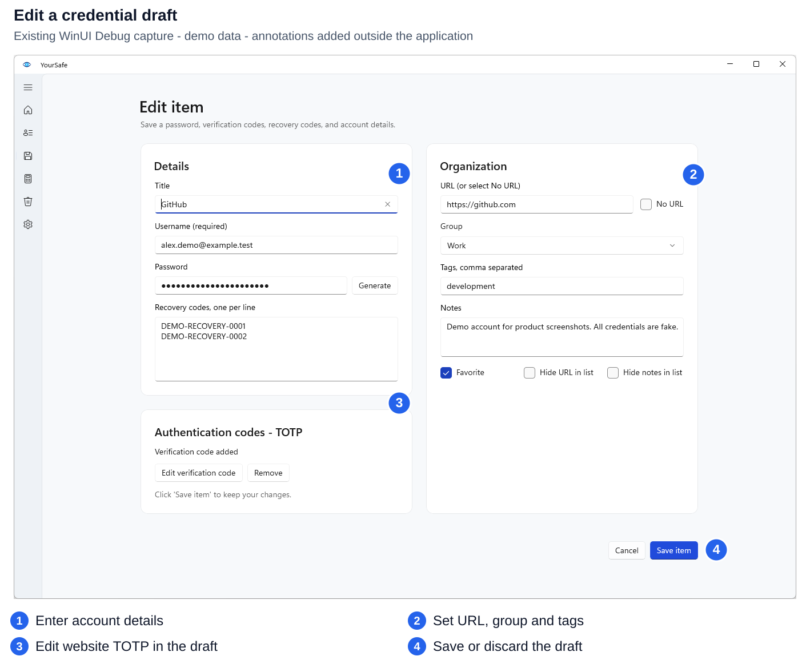
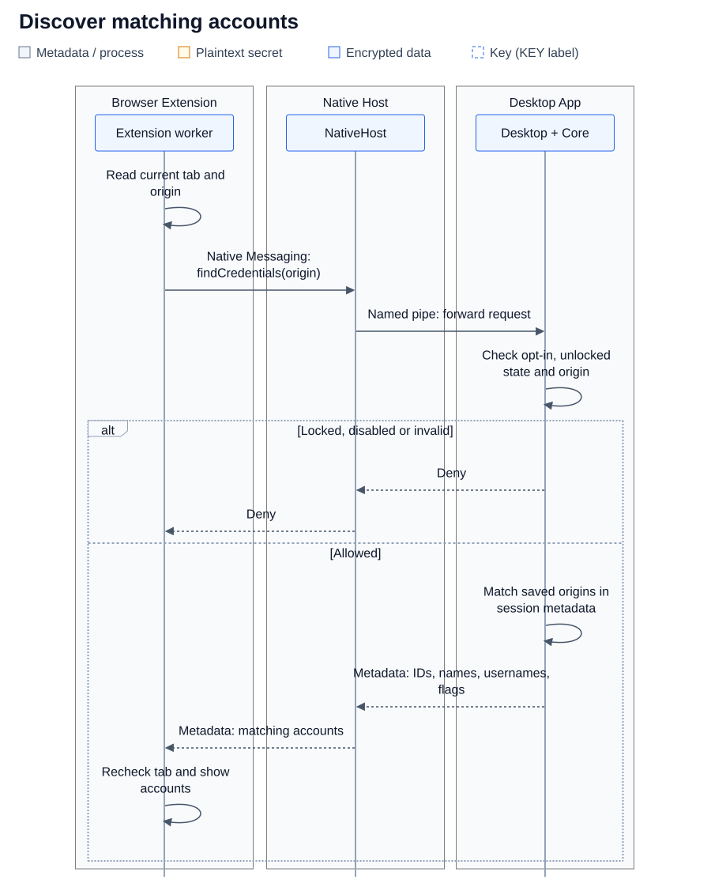

# YourSafe diagrams

These diagrams explain the current desktop vault and optional browser integration. They were checked against source on 2026-10-15. They summarize responsibilities and decisions, rather than every internal call. Application logic and security behavior are unchanged.

## Reading the figures

- Workflows run left to right; the state diagram runs top to bottom. Sequence diagrams read top to bottom across named component boundaries.
- Rectangles represent processing or explicitly labeled data; diamonds are decisions; cylinders are persistent storage. Dashed containers mark component/storage boundaries, not a guarantee of isolation from same-user malware.
- Neutral labels identify metadata or ordinary processing. Amber identifies plaintext secrets and decisions. Blue identifies encrypted data; a dashed blue outline with a **KEY** label identifies a key. Green marks completed actions; red marks rejected or failed actions. Read the labels as well as colors.
- Request metadata includes the client-reported origin and selected ID. Discovery metadata contains IDs, titles, usernames and capability flags. Plaintext passwords are returned only through the separately approved secret action.
- The local vault's `.storage` payload is encrypted. Its paired `.config` contains wrapped keys, an encrypted sign-in TOTP secret, and unencrypted operational metadata; the entire config is not ciphertext.
- Open an SVG at full size to inspect details on a small screen. Every figure has a text explanation and accessible title/description. No real credentials, keys, or TOTP seeds are shown.

## Collection

| Topic | Diagram type | Editable source | Figure |
| --- | --- | --- | --- |
| Vault overview | Annotated native screenshot | [SVG](vault-overview.svg) | [Open](vault-overview.svg) |
| Editor overview | Annotated native screenshot | [SVG](editor-overview.svg) | [Open](editor-overview.svg) |
| Save a credential | Flowchart | [Mermaid](save-credential.mmd) | [SVG](save-credential.svg) |
| Reveal/copy a password | Flowchart | [Mermaid](reveal-copy.mmd) | [SVG](reveal-copy.svg) |
| Find matching accounts | Sequence | [Mermaid](browser-discovery.mmd) | [SVG](browser-discovery.svg) |
| Approve one password fill | Sequence | [Mermaid](browser-fill.mmd) | [SVG](browser-fill.svg) |
| Vault key paths | Cryptographic data flow | [Mermaid](vault-keys.mmd) | [SVG](vault-keys.svg) |
| Login/lock lifecycle | State diagram | [Mermaid](vault-lifecycle.mmd) | [SVG](vault-lifecycle.svg) |
| Export a backup | Flowchart | [Mermaid](backup-export.mmd) | [SVG](backup-export.svg) |
| Recover on a fresh installation | Flowchart | [Mermaid](backup-recovery.mmd) | [SVG](backup-recovery.svg) |
| Restore a snapshot | Flowchart | [Mermaid](snapshot-restore.mmd) | [SVG](snapshot-restore.svg) |
| Reset with a Recovery Key | Flowchart | [Mermaid](recovery-key-reset.mmd) | [SVG](recovery-key-reset.svg) |

### Vault and editor

Audience: users. Purpose: locate account search, groups, protected actions, editor fields, TOTP drafts, and Save/Cancel.




These are existing native WinUI Debug captures with synthetic demo data, not generated UI or a fresh release qualification. The screenshots retain their original pixels and aspect ratios. Only SVG annotation markers and captions were added. Source PNGs: [vault](../../website/assets/homepage/desktop-vault.png), [editor](../../website/assets/homepage/desktop-editor.png). Their origin is recorded in [asset provenance](../../website/assets/PROVENANCE.md); each SVG also embeds the source path and SHA-256 digest. The UI remains in [MainPage.xaml](../../src/PasswordTool.WinUI/MainPage.xaml) and [MainPage.xaml.cs](../../src/PasswordTool.WinUI/MainPage.xaml.cs).

### Save a credential

Audience: users and developers. Purpose: explain how a draft becomes persisted encrypted data.


The plaintext editor draft is validated before encryption with the DEK. Staging reads back the pair and snapshots the previous complete state before replacement. Success stores the vault pair; errors reject or roll back the mutation. The config retains metadata and wrapped keys, not a raw DEK. Cancellation discards the draft.

Verified implementation: [SaveItemAsync](../../src/PasswordTool.Presentation/ShellViewModel.cs#L400), [AddItem/UpdateItem](../../src/PasswordTool.Core/Services/VaultService.cs#L1335), [SaveVault](../../src/PasswordTool.Core/Services/VaultService.cs#L1482), [paired storage transaction](../../src/PasswordTool.Core/Services/VaultStorageService.cs#L196).

### Reveal or copy

Audience: users and developers. Purpose: show authorization before releasing one selected password to the UI.


An unlocked vault uses the active login. A table-locked action asks for the Master Password, unlocks temporarily, attempts the read, and relocks in `finally`, including on failure. Core rechecks deadlines and item availability; stale/cancelled UI results are discarded. Reveal/copy does not ask for another TOTP during the same login. Clipboard cleanup is best effort after 30 seconds and on lock, only for a still-owned value; this does not retract an earlier paste or another process's copy.

Verified implementation: [RevealPasswordAsync](../../src/PasswordTool.Presentation/ShellViewModel.cs#L512), [CopyPasswordAsync](../../src/PasswordTool.Presentation/ShellViewModel.cs#L566), [RunVaultAsync](../../src/PasswordTool.Presentation/AppFlowCoordinator.cs#L733), [GetPassword](../../src/PasswordTool.Core/Services/VaultService.cs#L1165), [sensitive clipboard](../../src/PasswordTool.WinUI/SensitiveClipboardService.cs#L53).

### Browser discovery

Audience: users and integration developers. Purpose: distinguish account metadata discovery from secret disclosure.



Browser integration starts off each app session. When enabled and explicitly unlocked, discovery shares matching metadata without an individual approval. Native Messaging uses stdin/stdout; the host/desktop hop uses a named pipe. Neither the host nor the extension opens vault files. Core uses the already-unlocked desktop session. The official worker rechecks the actual browser target; the desktop cannot independently attest the client-reported website or extension identity.

Verified implementation: [worker discovery](../../browser-extension/src/worker.ts#L111), [FindAutofillCredentialsAsync](../../src/PasswordTool.Presentation/AppFlowCoordinator.cs#L372), [NativeHost transport](../../src/PasswordTool.NativeHost/Program.cs), [desktop pipe](../../src/PasswordTool.WinUI/AutofillPipeServer.cs), [origin policy](../../src/PasswordTool.Presentation/Autofill/AutofillPolicy.cs).

### Browser password fill

Audience: users and integration developers. Purpose: locate desktop approval and both sides' rechecks before one password fill.


This follows a successful discovery and explicit Fill selection. Ineligible requests stop before an approval dialog. Denial, timeout, lock, mutation or changed origin returns no password. Approval permits only the selected action; the desktop rechecks session, item and revision before disclosure. The official worker and content script also recheck document, fields and form, then fill without submitting. The reported origin is unverified to the desktop. NativeHost transports plaintext approved values; it does not own vault keys or run a hash API.

**View code** has its own approval and returns only a current website code and window metadata. **Copy code** has a separate approval and writes through the desktop clipboard service, returning an acknowledgement. Neither action releases the website TOTP seed or vault sign-in Authenticator; countdowns never renew approval or retrieve new codes.

Verified implementation: [worker explicit actions](../../browser-extension/src/worker.ts#L127), [approved desktop action](../../src/PasswordTool.Presentation/AppFlowCoordinator.cs#L407), [approval disclosure](../../src/PasswordTool.WinUI/AutofillApprovalService.cs), [field validation](../../browser-extension/src/fields.ts), [pipe response projections](../../src/PasswordTool.WinUI/AutofillPipeServer.cs#L133).

### Keys and encrypted storage

Audience: technical users and developers. Purpose: show the two independent paths to the same vault key, without depicting TOTP as encryption.


The Master Password derives a KEK through Argon2id; the random Recovery Key is a separate key. Their independent AES-256-GCM wrappers live in `.config`. Either wrapper can unwrap the same 256-bit DEK; authentication errors stop decryption. The DEK protects `.storage` and the sign-in Authenticator secret in `.config` with separate contexts. Website TOTP seeds live inside encrypted entries; the sign-in Authenticator is separate.

TOTP authorizes the normal app sign-in after the Master Password key path succeeds. It never derives or wraps the DEK. Recovery Key access uses the reset wizard, not an alternate ordinary sign-in; that wizard replaces credentials and returns to Login. Backups have a different passphrase-derived key and are not unlocked with a Recovery Key.

Verified implementation: [MasterPasswordService](../../src/PasswordTool.Core/Services/MasterPasswordService.cs#L165), [RecoveryKeyService](../../src/PasswordTool.Core/Services/RecoveryKeyService.cs#L32), [EncryptionService](../../src/PasswordTool.Core/Services/EncryptionService.cs), [session TOTP verification](../../src/PasswordTool.Core/Services/VaultService.cs#L617).

### Login and lock lifecycle

Audience: users and developers. Purpose: distinguish login authorization from the shorter vault-open duration.


This covers an already-enrolled vault; first-launch setup and older-format enrollment are outside this figure. Successful initial sign-in requires Master Password + TOTP. Login lasts at most five hours; unlock and activity never extend it. The vault deadline is measured from unlock and defaults to one minute. Table lock keeps visible metadata; Windows lock/disconnect/suspend/resume clears it. Either locked state can reopen with the correct Master Password while login remains active. Wrong passwords/cancellation keep it locked. Temporary actions relock on success or failure. Any login expiry/logout/app exit ends authorization.

Verified implementation: [UnlockAsync](../../src/PasswordTool.Presentation/AppFlowCoordinator.cs#L192), [LockAsync/LockTableAsync](../../src/PasswordTool.Presentation/AppFlowCoordinator.cs#L323), [temporary desktop action](../../src/PasswordTool.Presentation/AppFlowCoordinator.cs#L733), [Core expiration and deadlines](../../src/PasswordTool.Core/Services/VaultService.cs#L72), [Windows lifecycle monitor](../../src/PasswordTool.WinUI/SystemLockMonitor.cs).

### Export an encrypted backup

Audience: users and developers. Purpose: show external entry export with its separate passphrase and verification.



An authorized vault action exports entries. PBKDF2-SHA256 (600,000 iterations, random 16-byte salt) derives the separate backup key; AES-256-GCM encrypts the payload. The writer verifies the temporary file before replacing the destination, then verifies the final file. Failure before replacement preserves an older destination; a final verification failure can leave a written file that must not be trusted. Backup-status recording can fail separately after a backup was written and verified. The live vault is not replaced by export. Group definitions, appearance settings and sign-in credentials are excluded.

Verified implementation: [CreateExternalBackupFile](../../src/PasswordTool.Core/Services/VaultService.cs#L387), [external writer](../../src/PasswordTool.Core/Services/VaultService.cs#L1545), [backup encryption and item envelope](../../src/PasswordTool.Core/Services/VaultBackupService.cs).

### Recover on a fresh installation

Audience: users and developers. Purpose: explain creating a new vault from encrypted entry data.


Neither `.config` nor `.storage` may already exist. The UI authenticates and inspects the backup with its passphrase before asking for new credentials; Core revalidates the inputs at commit. Confirm a new Master Password, a newly saved Recovery Key and a new sign-in Authenticator code. Recovery generates a fresh DEK, encrypts recovered entries, and commits a new pair before beginning a new unlocked login. Failure stops the flow; it does not authorize overwriting an existing vault. Group organization is not restored. A Recovery Key cannot decrypt an external backup.

Verified implementation: [InspectRecoveryBackupAsync/CompleteRecoveryAsync](../../src/PasswordTool.Presentation/AppFlowCoordinator.cs#L267), [RecoverFromBackup](../../src/PasswordTool.Core/Services/VaultService.cs#L409), [verified recovery commit](../../src/PasswordTool.Core/Services/VaultService.cs#L205).

### Restore a local snapshot

Audience: users and developers. Purpose: distinguish paired local rollback from external backup recovery.



Restore is an authorized vault action. The current Master Password authorizes replacement; the snapshot's Master Password authenticates its pair when different. Restore verifies staged key, Authenticator and payload before replacement, then ends login. Sign in with the restored credentials. Rejected input or a failed write rejects/rolls back replacement; snapshots keep their own security state and remain on the same disk.

Verified implementation: [TryRestoreSnapshot](../../src/PasswordTool.Core/Services/VaultService.cs#L838), [RestoreSnapshot and paired transaction](../../src/PasswordTool.Core/Services/VaultStorageService.cs#L167).

### Reset with a Recovery Key

Audience: users and developers. Purpose: replace credentials for the current vault without recovering a backup or opening a session.



The current Recovery Key unwraps the existing DEK and authenticates the vault. The wizard requires a new Master Password, a saved fresh Recovery Key and a verified replacement Authenticator. It commits new wrappers/config together, preserves vault ciphertext, clears login state and returns to sign-in. Cancel or invalid input leaves the old state; failed writes roll back. It does not decrypt a backup or revoke older snapshots/copies.

Verified implementation: [reset wizard](../../src/PasswordTool.Presentation/AppFlowCoordinator.cs#L117), [ResetWithRecoveryKey](../../src/PasswordTool.Core/Services/VaultService.cs#L154), [SaveRecoveryState](../../src/PasswordTool.Core/Services/VaultService.cs#L205).

## Editing and regeneration

The ten `.mmd` files are the editable semantic sources. The two screenshot SVGs are their own editable source: their embedded PNG pixels stay unchanged while callout positions/text can be edited. Most diagram SVGs include a visible title/legend wrapper plus Mermaid's vector output. The lifecycle SVG uses a manually routed vector layout to separate transition labels; its Mermaid file records the same states and transitions. SVG metadata records the semantic source digest. Source screenshots and native transport are not synthesized with ImageGen.

The Mermaid figures were rendered with Mermaid 11.12.0 and [theme.json](theme.json), with HTML labels disabled. With an installed Mermaid CLI, the graph itself can be regenerated, for example:

```powershell
mmdc -i docs/diagrams/save-credential.mmd -o save-credential-body.svg -c docs/diagrams/theme.json -b white
```

Keep the SVG title/legend wrapper when replacing its graph body, or preserve the same labeled data classes in a fresh export. Edit the lifecycle SVG's paths/labels directly when changing its layout; a plain Mermaid export will use Mermaid's own routing. Recheck source digests when changing an SVG/source pair. See [Mermaid usage](https://mermaid.js.org/config/usage.html) and [Mermaid CLI](https://github.com/mermaid-js/mermaid-cli) for renderer setup. No rendering dependency is added to the application.

Authoring brief: explain one verified workflow per figure; preserve the labeled component boundaries, data classes and Allow/Deny or Success/Failure paths. Use concise English, left-to-right flows, a top-to-bottom state diagram, and the shared blue/green/amber/red palette. Split complexity rather than shrink text. Inspect the rendered output at documentation width and open full size on small screens. Do not add APIs, cryptographic guarantees, auto-save, browser attestation, or security behavior absent from source.

Scope limits: existing screenshots demonstrate UI with synthetic accounts, not a fresh live browser/desktop test. These documentation checks do not establish runtime security, production signing, or browser-store qualification.
