# YourSafe diagrams

These figures describe the implementation reviewed on **2026-11-10**. They follow a user action through authorization, validation, data movement and its result. The review used the current C# and TypeScript source and relevant test cases; it is not a new desktop/browser runtime qualification.

[Back to the main README](../../README.md) · [Architecture and compatibility rules](../architecture.md)

## Find the right diagram

| Question | Topic | Editable source | Figure |
| --- | --- | --- | --- |
| What runs locally, and what calls what? | [System architecture](#system-architecture) | [Mermaid](system-architecture.mmd) | [SVG](system-architecture.svg) |
| What happens on first launch? | [First launch](#first-launch) | [Mermaid](first-launch.mmd) | [SVG](first-launch.svg) |
| When is my Authenticator code requested? | [Sign-in](#sign-in) | [Mermaid](sign-in.mmd) | [SVG](sign-in.svg) |
| What is inside the vault? | [Vault data model](#vault-data-model) | [Mermaid](vault-data-model.mmd) | [SVG](vault-data-model.svg) |
| How does Save reach the encrypted files? | [Save a credential](#save-a-credential) | [Mermaid](save-credential.mmd) | [SVG](save-credential.svg) |
| What if a write fails or the process stops? | [Paired persistence](#paired-persistence) | [Mermaid](storage-transaction.mmd) | [SVG](storage-transaction.svg) |
| What authorizes Reveal and Copy? | [Reveal or copy](#reveal-or-copy) | [Mermaid](reveal-copy.mmd) | [SVG](reveal-copy.svg) |
| What is the difference between login and unlock? | [Login and lock lifecycle](#login-and-lock-lifecycle) | [Mermaid](vault-lifecycle.mmd) | [SVG](vault-lifecycle.svg) |
| How are password changes and deletion handled? | [Password lifecycle and Trash](#password-lifecycle-and-trash) | [Mermaid](password-lifecycle.mmd) | [SVG](password-lifecycle.svg) |
| Which TOTP operations are live or one-time? | [Website TOTP](#website-totp) | [Mermaid](website-totp.mmd) | [SVG](website-totp.svg) |
| What can discovery disclose? | [Browser discovery](#browser-discovery) | [Mermaid](browser-discovery.mmd) | [SVG](browser-discovery.svg) |
| Where is a browser Fill approved and checked? | [Browser password fill](#browser-password-fill) | [Mermaid](browser-fill.mmd) | [SVG](browser-fill.svg) |
| How are keys related to the encrypted files? | [Keys and encrypted storage](#keys-and-encrypted-storage) | [Mermaid](vault-keys.mmd) | [SVG](vault-keys.svg) |
| Which recovery operation should I choose? | [Choose a recovery path](#choose-a-recovery-path) | [Mermaid](recovery-options.mmd) | [SVG](recovery-options.svg) |
| When is an exported backup considered verified? | [Export an encrypted backup](#export-an-encrypted-backup) | [Mermaid](backup-export.mmd) | [SVG](backup-export.svg) |
| How do I recover after losing a PC? | [Recover on a fresh installation](#recover-on-a-fresh-installation) | [Mermaid](backup-recovery.mmd) | [SVG](backup-recovery.svg) |
| Will importing replace existing entries? | [Import into an existing vault](#import-into-an-existing-vault) | [Mermaid](import-merge.mmd) | [SVG](import-merge.svg) |
| What does restoring a snapshot replace? | [Restore a local snapshot](#restore-a-local-snapshot) | [Mermaid](snapshot-restore.mmd) | [SVG](snapshot-restore.svg) |
| Can I replace lost login credentials? | [Reset with a Recovery Key](#reset-with-a-recovery-key) | [Mermaid](recovery-key-reset.mmd) | [SVG](recovery-key-reset.svg) |
| How does the separate hashing API work? | [Optional hash API](#optional-hash-api) | [Mermaid](hash-api.mmd) | [SVG](hash-api.svg) |
| Where are the controls in the desktop UI? | [Vault and editor](#vault-and-editor) | Annotated screenshot SVGs | [Vault](vault-overview.svg) · [Editor](editor-overview.svg) |

## Reading the figures

Flowcharts generally run top to bottom; follow arrowheads and branch labels. Sequences run top to bottom across named participants. The data model describes encrypted JSON and projections, not SQL tables. Open an SVG at full size to zoom into detailed figures.

- Rectangles are processing or labeled data, diamonds are decisions, and cylinders are stored data. Double-border nodes refer to a shared workflow explained elsewhere.
- **SECRET** means plaintext sensitive data; **KEY** identifies an encryption key. Blue marks encrypted data/key paths, amber marks selected plaintext secrets, green marks success, and red marks rejection/failure. Labels carry the meaning even without color.
- Component boxes show responsibility/process groupings. They do not guarantee isolation from same-user malware. Runtime arrows are distinct from .NET project references.
- A secret-free projection excludes password values, TOTP seeds, recovery-code values and password history. It can still expose identifying metadata such as titles, usernames, URLs or visible notes.
- `.storage` is encrypted; `.config` contains encrypted key slots and the encrypted sign-in TOTP secret alongside readable operational metadata. The entire config is not ciphertext.

Every generated SVG has an accessible title/description and the SHA-256 of its Mermaid source. No real credentials or seeds are illustrated.

## System architecture


The desktop owns the vault session. The optional extension sends requests to that running desktop; neither the extension nor NativeHost opens vault files. The hashing API is an independent process and does not participate in autofill.

| Component | Owns |
| --- | --- |
| WinUI | Views, editor drafts, native dialogs, lifecycle events, clipboard and file pickers. |
| Presentation | ViewModels, flow state, metadata caches, action authorization and pending browser approval. |
| VaultOperationRunner | A single semaphore serializes synchronous Core operations on a background task. Approval dialogs are awaited outside this gate. |
| Core VaultService | Decrypted session, deadlines, item rules, encryption, imports and recovery workflows. |
| VaultStorageService | Bounded file reads, staging, snapshots, journal and paired replacement. |
| NativeHost | Protocol framing/validation and pipe relay; no Core/Presentation project reference. WireProtocol.cs is linked into its build. |
| Browser worker/content | Browser-derived document identity, explicit action selection, response validation and destination-field checks. |
| Hash API | HTTP-specific checks and hashing/inspection contracts over Core. |

Source: [DI composition](../../src/PasswordTool.WinUI/ServiceRegistration.cs), [operation runner](../../src/PasswordTool.Presentation/VaultOperationRunner.cs), [flow coordinator](../../src/PasswordTool.Presentation/AppFlowCoordinator.cs), [NativeHost project](../../src/PasswordTool.NativeHost/PasswordTool.NativeHost.csproj).

## First launch


Startup distinguishes three cases: a complete pair opens sign-in; no files allows Create or Recover; a partial pair blocks creation/recovery rather than overwriting the surviving file. Before those decisions, the storage constructor attempts to complete a structurally valid pending journal.

New setup collects a confirmed Master Password, verifies a generated sign-in Authenticator secret with its current code, and asks the user to save a fresh Recovery Key. Core checks those inputs again, creates a new random DEK and empty vault, then verifies both key wrappers and ciphertext in staging. Only a successful commit starts an unlocked login. Cancel before commit creates no vault; interrupted persistence follows [paired persistence](#paired-persistence).

Source: [initial state and setup](../../src/PasswordTool.Presentation/AppFlowCoordinator.cs), [setup dialogs](../../src/PasswordTool.WinUI/MainPage.xaml.cs), [InitializeNewVault](../../src/PasswordTool.Core/Services/VaultService.cs).

## Sign-in


The sign-in button first calls `ValidateMasterPasswordAsync`. This derives/unwraps a key and authenticates the vault without opening a login or writing storage. An invalid password stops before the OTP prompt. A new login then asks for the current six-digit Authenticator code; reopening an existing active login skips that prompt.

Final `UnlockAsync` repeats the cryptographic checks inside the serialized runner and verifies the OTP or existing login authorization. Decryption and application authorization are separate steps: successfully decrypting data alone does not authorize the workspace. An expired or changed lifecycle discards the result. Configs requiring Recovery Key enrollment go through that step before ordinary workspace access.

A new login deadline is now + five hours. Each unlock sets a separate vault deadline to the earlier of now + configured duration and the existing login deadline. The default vault duration is one minute, and activity never extends either deadline.

Source: [UnlockButton_Click](../../src/PasswordTool.WinUI/MainPage.xaml.cs), [UnlockAsync](../../src/PasswordTool.Presentation/AppFlowCoordinator.cs), [ValidateMasterPassword / VerifyTotpForSession](../../src/PasswordTool.Core/Services/VaultService.cs). Related cases: [login/deadline tests](../../tests/PasswordTool.Core.Tests/RecoveryKeyAndDeadlineTests.cs).

## Vault data model


`VaultData` v3 contains items and groups inside one encrypted payload. Each item has zero or one `GroupId`; null is unassigned. **All** is an aggregate UI filter, not a persisted group. TOTP and recovery-code boxes are conceptual parts of an item: TOTP fields and recovery-code arrays are stored on `VaultItem`, not in separate tables.

A `Password` item can hold a password, website TOTP and account recovery codes together. Core also accepts passwordless TOTP/recovery-code items; the current desktop editor additionally requires Title, Username and Password. A nonempty recovery-code list needs at least two valid unique codes. Legacy `RecoveryCodes` items cannot hold a password or TOTP seed.

Desktop list and browser discovery shapes are projections. List rows never hold password values or TOTP seeds; hidden URLs/notes are omitted as appropriate. Browser metadata is narrower: ID, title, username and password/TOTP capability flags. External encrypted backups contain items, history and Trash state, but no group definitions or appearance settings.

Source: [VaultData](../../src/PasswordTool.Core/Models/VaultData.cs), [VaultItem](../../src/PasswordTool.Core/Models/VaultItem.cs), [VaultGroup](../../src/PasswordTool.Core/Models/VaultGroup.cs), [desktop projection](../../src/PasswordTool.Presentation/VaultItemListItem.cs), [wire shapes](../../src/PasswordTool.Presentation/Autofill/WireProtocol.cs).

## Save a credential


WinUI checks the required editor fields and URL-or-No-URL choice. Presentation converts the draft and invokes Add/Update through the authorized runner. Core validates the actual item, selected group, TOTP parameters and recovery-code list. New entries receive new IDs/timestamps; updates preserve identity and handle password history.

Core encrypts the whole vault payload with the session DEK and purpose-bound AES-GCM context, then uses the shared paired transaction. A successful save refreshes metadata and returns to Vault. Persistence failure reverses the in-memory mutation when that same data is still loaded; a lock must not restore cleared secrets. Stale lifecycle results never navigate the UI as a successful action. Cancel only discards the editor draft after the relevant discard confirmation.

Source: [editor input](../../src/PasswordTool.Presentation/VaultItemEditorInput.cs), [SaveItemAsync](../../src/PasswordTool.Presentation/ShellViewModel.cs), [AddItem / UpdateItem / SaveVault](../../src/PasswordTool.Core/Services/VaultService.cs). Related cases: [mutation rollback tests](../../tests/PasswordTool.Core.Tests/VaultPersistenceRollbackTests.cs).

## Paired persistence


`.config` and `.storage` form one logical state change, implemented by sequential file operations:

1. Read the previous bounded files, write two temporary files, and reread their serialized documents.
2. Invoke the caller's verification. Setup/reset validates both wrappers and the decrypted payload; snapshot restore authenticates historical state. Ordinary saves supply session/deadline checks rather than a full decrypt-and-compare roundtrip.
3. Recheck authorization when a callback is supplied and snapshot the previous complete pair.
4. Recheck again, write the **target** pair to `.state-transaction`, replace config, then replace storage.
5. Delete the journal, keep up to five snapshots, and clean temporary files.

On an exception the writer attempts to restore both previous files, or delete newly created ones. It only attempts journal removal after both restorations succeed. If rollback cannot complete, the failure is reported and a remaining journal can still be present. This is not a single filesystem-atomic swap or a guarantee against every disk failure.

At next construction, a valid pending journal is replayed toward its target pair, then deleted. Structural validation failure leaves it for diagnosis; normal vault unlock later authenticates ciphertext. Do not mix file versions or manually delete a journal to force the app to open.

Source: [SaveRawState / RecoverInterruptedStateTransaction](../../src/PasswordTool.Core/Services/VaultStorageService.cs), [caller verification](../../src/PasswordTool.Core/Services/VaultService.cs). Related cases: [rollback](../../tests/PasswordTool.Core.Tests/VaultPersistenceRollbackTests.cs), [journal boundaries](../../tests/PasswordTool.Core.Tests/VaultStorageBoundarySecurityTests.cs), [interrupted setup/migration](../../tests/PasswordTool.Core.Tests/RecoveryKeyAndDeadlineTests.cs).

## Reveal or copy


An already-unlocked vault uses the active login. A table-locked desktop action asks for the Master Password, opens the vault temporarily and relocks in `finally`, including on errors. It preserves the original login deadline. Core rechecks item availability and deadlines; Presentation discards stale/cancelled results before a dialog or clipboard write.

Sensitive clipboard copies also recheck at the queued Windows write. Cleanup after 30 seconds and on lock only attempts to clear a value YourSafe still owns and recognizes; replacing the clipboard preserves the replacement. An earlier paste, another process's read, clipboard history and sync are outside that guarantee.

Source: [RevealPasswordAsync / CopyPasswordAsync](../../src/PasswordTool.Presentation/ShellViewModel.cs), [RunVaultAsync](../../src/PasswordTool.Presentation/AppFlowCoordinator.cs), [GetPassword](../../src/PasswordTool.Core/Services/VaultService.cs), [sensitive clipboard](../../src/PasswordTool.WinUI/SensitiveClipboardService.cs).

## Login and lock lifecycle


This figure covers an enrolled vault. Failed passwords/cancelled dialogs keep it locked; legacy enrollment is covered by [sign-in](#sign-in).

| Transition | Keys and secrets | Metadata and authorization |
| --- | --- | --- |
| Manual lock or vault deadline | Clears DEK and decrypted Core data. | Table metadata and the fixed login deadline can remain. |
| Temporary table-locked desktop action | Correct Master Password opens it only for that action, then relocks. | Does not create a normal unlock for browser/live TOTP actions. |
| Windows lock/disconnect/suspend/resume | Locks, cancels pending auth/secret work and closes secret UI. | Clears workspace caches; the login can remain active until its original deadline. |
| Unlock during active login | Master Password only. | Reopens for the configured duration, capped by login expiry. |
| Logout, login expiry or app exit | Ends login and clears application-held vault state. | A new sign-in requires Master Password + OTP. Logout disables browser integration. |

Saving a new duration does not change the duration cached for the current app instance; close and reopen the app for it to take effect. Windows lifecycle locking and table locking are distinct even though both prevent vault-secret reads.

Source: [LockAsync / LockTableAsync / LogoutAsync](../../src/PasswordTool.Presentation/AppFlowCoordinator.cs), [Core deadlines and LockVault](../../src/PasswordTool.Core/Services/VaultService.cs), [Windows lifecycle monitor](../../src/PasswordTool.WinUI/SystemLockMonitor.cs), [shell cleanup](../../src/PasswordTool.WinUI/MainPage.xaml.cs).

## Password lifecycle and Trash


Changing a nonempty password to another nonempty password keeps up to ten old values and sets `PasswordChangedAt`. Other field edits keep password age unchanged. Removing password data clears its history/age; legacy missing dates use bounded fallback metadata rather than letting future timestamps postpone a finding.

Local Security Check scans active nonempty passwords in memory. Weak means fewer than 12 characters or estimated entropy below 60 bits; reuse means exact ordinal equality; old means at least 365 days. Results contain item identity and findings, not password values. The user opens the selected ID through the protected editor, saves, then rescans.

Deleting an individual entry moves it to encrypted Trash. Restore clears deletion state; permanent deletion requires confirmation. Retention purge runs at a successful normal unlock, including password re-unlock during an active login, once 30 days have elapsed. Confirmed group deletion removes the group and **all** its entries, including Trash, directly from the current vault. Existing snapshots/backups are unaffected by either deletion path.

Source: [UpdateItem / GetSecurityFindings / DeleteItem / PurgeExpiredTrash / DeleteGroup](../../src/PasswordTool.Core/Services/VaultService.cs), [date fallback](../../src/PasswordTool.Core/Services/PasswordLifecycle.cs), [findings UI](../../src/PasswordTool.Presentation/SecurityCheckViewModel.cs), [Trash UI](../../src/PasswordTool.Presentation/TrashViewModel.cs).

## Website TOTP


The sign-in Authenticator belongs to the app; website TOTP belongs to a saved account. Editing a Base32 seed or otpauth URI updates the editor draft only. Save persists normalized SHA1/SHA256/SHA512, six/eight digits, period and issuer/account metadata.

A desktop 2FA/Details panel requires normal unlock, refreshes at code-window rotation, and stops/clears on close or lock. A table-locked UI must explicitly unlock before opening that live panel; the code-read API does not open a temporary password prompt. Copy generates a fresh code and validates its time window at clipboard execution, avoiding stale countdown values.

Browser View and Copy each use one approval. View returns only the code, period and expiry; Copy writes through the desktop clipboard and returns `copied=true`. Browser countdowns clear expired results and never fetch the next code automatically. Neither browser path returns a seed.

Source: [TOTP editor/flyout](../../src/PasswordTool.WinUI/MainPage.Totp.cs), [TotpPanel](../../src/PasswordTool.WinUI/TotpPanel.cs), [CopyTotpAsync](../../src/PasswordTool.Presentation/AppFlowCoordinator.cs), [popup worker](../../browser-extension/src/worker.ts). Related cases: [TOTP flow tests](../../tests/PasswordTool.Presentation.Tests/TotpFlowTests.cs).

## Browser discovery


Integration starts disabled each app session. Status and Open YourSafe remain available while it is disabled or locked; Open only foregrounds a running desktop. Discovery requires opt-in, an explicitly unlocked vault, supported origin and the protected-request quota. It needs no individual approval because it returns metadata only.

Origins compare scheme, normalized host and effective port. Paths do not narrow matching; subdomains and non-default ports differ. Public HTTPS and allowed loopback HTTP are supported. Missing/invalid/unrelated URLs and deleted items are excluded. NativeHost validates protocol v3; the desktop verifies the named-pipe peer and session. The worker validates response shapes and rechecks the exact tab/document/URL before showing results.

Control requests and protected requests have independent 30-per-minute quotas. Discovery responses are bounded and report truncation. The desktop cannot independently attest the browser-reported website or extension identity; peer-path/session checks and browser Native Messaging registration do not change that limit.

Source: [worker](../../browser-extension/src/worker.ts), [runtime protocol guards](../../browser-extension/src/protocol.ts), [origin policy](../../src/PasswordTool.Presentation/Autofill/AutofillPolicy.cs), [pipe server](../../src/PasswordTool.WinUI/AutofillPipeServer.cs), [NativeHost](../../src/PasswordTool.NativeHost/Program.cs), [peer checks](../../src/PasswordTool.NativeHost/PipePeer.cs).

## Browser password fill


After explicit account selection, the worker binds the action to the active top-level document. Content preparation rejects hidden, non-editable or ambiguous fields before requesting a password. The desktop snapshots the candidate and mutation version, then waits for Allow once outside the Core-operation gate. Only one approval may be pending; its desktop deadline is 60 seconds.

After approval, desktop checks opt-in, normal unlock, lifecycle, mutation version, ID, origin and candidate equality again. The pipe checks its original delivery guard at response write. Native Messaging and pipe framing are bounded to 64 KiB; the worker transport/interaction uses a 70-second outer lifetime. Disconnect, Cancel, integration off, lock, mutation, or stale target can invalidate the request. Reopening the popup resumes the same pending operation without sending another secret request or extending its deadline.

The approved username/password necessarily passes as plaintext through NativeHost and the worker. Before delivery/fill, the worker rechecks its exact target; the content script checks the prepared field identities, visibility, URL and form again, including after username events and before writing the password. Filling uses native setters plus input/change events and never submits. Once delivered to the page, page code can observe the values.

Source: [worker action/lifetime](../../browser-extension/src/worker.ts), [native request queue](../../browser-extension/src/native.ts), [content token](../../browser-extension/src/content.ts), [field validation/fill](../../browser-extension/src/fields.ts), [RunApprovedAutofillAsync](../../src/PasswordTool.Presentation/AppFlowCoordinator.cs), [approval dialog](../../src/PasswordTool.WinUI/AutofillApprovalService.cs). Related cases: [approval invalidation tests](../../tests/PasswordTool.Presentation.Tests/AutofillApprovalTests.cs).

## Keys and encrypted storage


The Master Password derives a 256-bit KEK with Argon2id: three passes, 64 MiB, parallelism two and a fresh 32-byte salt. A random 256-bit Recovery Key supplies an independent KEK without a password KDF. Their AES-256-GCM wrappers live in separate config slots and unwrap the same random DEK.

The DEK protects `.storage` and the sign-in Authenticator seed using different purpose-bound contexts. A wrong key or failed authentication stops decryption. Website TOTP seeds remain inside encrypted items; the app's sign-in secret is separate in config.

TOTP verifies ordinary app login **after** the password key path; it never derives or wraps a key. Recovery Key access can validate the ciphertext for reset, but does not itself open a workspace session. External backups use a separate passphrase-derived key and cannot be decrypted with the vault Recovery Key.

Source: [MasterPasswordService](../../src/PasswordTool.Core/Services/MasterPasswordService.cs), [RecoveryKeyService](../../src/PasswordTool.Core/Services/RecoveryKeyService.cs), [EncryptionService](../../src/PasswordTool.Core/Services/EncryptionService.cs), [session verification](../../src/PasswordTool.Core/Services/VaultService.cs).

## Choose a recovery path


| Operation | Required access/material | Effect on current data and credentials |
| --- | --- | --- |
| Recovery Key reset | Current vault pair and its current Recovery Key. | Keeps DEK/entries; replaces Master Password, Recovery Key and sign-in Authenticator; returns to sign-in. |
| Local snapshot restore | Current authorized vault, current Master Password, and snapshot password when different. | Replaces the whole pair, including historical login settings/keys; ends login. |
| Fresh-installation recovery | External encrypted backup, its passphrase, no local vault files, and newly confirmed credentials. | Creates new vault/DEK and begins a new unlocked login. |
| Backup import | Existing authorized vault and backup passphrase. | Adds new IDs only; existing entries and login credentials remain. |

Snapshots are on the same disk. Neither they nor a Recovery Key substitute for an external backup after disk loss. Losing a backup passphrase affects that backup, not an otherwise usable live vault. There is no hosted vault copy or account-recovery service.

Source: the four workflows below; [operation entry points](../../src/PasswordTool.Presentation/BackupViewModel.cs).

## Export an encrypted backup


An authorized desktop action validates the complete item payload and the confirmed 12–4096-character passphrase. PBKDF2-SHA256 with 600,000 iterations and a random 16-byte salt derives the independent backup key; AES-256-GCM encrypts the version-1 entry envelope. Group definitions, appearance and sign-in credentials are excluded; favorites, TOTP configuration, history and Trash are included.

The writer authenticates the entire temporary file before replacing a destination, then authenticates the final file. Pre-replacement verification failure preserves an older destination. Final verification failure can leave a written file that must not be relied on. Successful verification is followed by a separate paired config update for backup-health timestamps; that status update can fail while the backup itself remains usable. File-system or validation failures also report errors.

Source: [CreateExternalBackupFile / WriteExternalBackupFile](../../src/PasswordTool.Core/Services/VaultService.cs), [backup format/encryption/inspection](../../src/PasswordTool.Core/Services/VaultBackupService.cs), [ExportAsync](../../src/PasswordTool.Presentation/BackupViewModel.cs).

## Recover on a fresh installation


Both `.config` and `.storage` must be absent. Inspection authenticates/decrypts the full backup but returns only format, version, creation time and item/type/active/Trash counts. The setup wizard then collects new credentials, confirms the new Recovery Key was saved and verifies a new sign-in Authenticator code.

At commit, Core rechecks empty storage and input, rereads the backup, generates a new DEK, encrypts recovered entries, and verifies both new wrappers and ciphertext in staging. Unknown group references become unassigned because group definitions are absent from the backup. Success records verification time and starts a new unlocked login; it does not reuse the old config, keys or sign-in Authenticator.

Source: [InspectRecoveryBackupAsync / CompleteRecoveryAsync](../../src/PasswordTool.Presentation/AppFlowCoordinator.cs), [RecoverFromBackup / SaveRecoveryState](../../src/PasswordTool.Core/Services/VaultService.cs). Related cases: [backup recovery tests](../../tests/PasswordTool.Core.Tests/VaultRecoveryTests.cs).

## Import into an existing vault


Backup import fully authenticates/validates the envelope and items before classifying each ID: absent is new, equivalent is duplicate, and different content under the same ID is conflict. Only new IDs are added. Unknown group references are cleared; matching local group IDs can remain.

CSV uses a different account comparison: title and URL ignore case; username, password and complete TOTP configuration must match. It skips non-login rows and rows with neither password nor TOTP, so TOTP-only rows can be imported. Imported rows receive fresh IDs/timestamps; legacy folder names can create/map groups. Both routes bound input to 10 MiB; CSV additionally bounds rows, columns and fields.

Preview is not an authorization token or reserved import plan. The import action rereads the file and recomputes against current data. A save failure removes additions and restores CSV group changes while the data is still loaded. Existing entries are never overwritten, and the source CSV is not retained by YourSafe; the user's original file remains plaintext.

Source: [preview/import commands](../../src/PasswordTool.Presentation/BackupViewModel.cs), [ImportBackupJson / ImportCsv](../../src/PasswordTool.Core/Services/VaultService.cs), [backup comparison](../../src/PasswordTool.Core/Services/VaultBackupService.cs), [CSV parser and AreEquivalentAccount](../../src/PasswordTool.Core/Services/VaultCsvImportService.cs).

## Restore a local snapshot


The current Master Password authorizes replacement. The snapshot's password authenticates its selected historical config/storage pair when different. Staged checks verify its Master slot, Authenticator secret and decrypted payload; they do not ask for a live OTP from the historical Authenticator. Current authorization is rechecked before replacement, and compatibility-token removal happens before live files are replaced.

Success ends login. Sign in with the **restored** password and Authenticator, and expect the restored security settings and key revision. Invalid or incomplete snapshots reject without replacement; write failures attempt pair rollback. Local snapshots remain on the same disk and retain old credentials even after live credentials are rotated.

Source: [RestoreSnapshotAsync](../../src/PasswordTool.Presentation/BackupViewModel.cs), [TryRestoreSnapshot](../../src/PasswordTool.Core/Services/VaultService.cs), [RestoreSnapshot / SaveRawState](../../src/PasswordTool.Core/Services/VaultStorageService.cs). Related cases: [snapshot verification tests](../../tests/PasswordTool.Core.Tests/VaultSnapshotVerificationTests.cs).

## Reset with a Recovery Key


The wizard validates the current Recovery Key against config v4 and authenticates the current vault before collecting replacements. It requires a different Master Password, a fresh saved Recovery Key and a different Authenticator seed verified by a current code. Core repeats these checks at commit.

Reset keeps the existing DEK and vault ciphertext, replaces both wrappers and the encrypted sign-in Authenticator, and increments credential revision. Staging verifies both new wrappers resolve to the expected DEK and the new Authenticator matches the verified setup. Success clears session and compatibility token and returns to sign-in. Cancel/invalid input stops before commit; failed persistence attempts pair rollback. Older snapshots and copied vault pairs retain their own old credentials.

Source: [reset wizard state](../../src/PasswordTool.Presentation/AppFlowCoordinator.cs), [ResetWithRecoveryKey / SaveRecoveryState](../../src/PasswordTool.Core/Services/VaultService.cs). Related cases: [reset and credential-reuse tests](../../tests/PasswordTool.Core.Tests/RecoveryKeyAndDeadlineTests.cs).

## Optional hash API


This separate Minimal API exposes `/api/password/hash`, `/verify`, `/inspect` and `/algorithms`. It has no vault endpoint. Loopback peer plus localhost/loopback Host checks reject other callers with 403. Allowed responses get no-store; HTTP redirects to HTTPS. Body size is capped at 32 KiB; the global limit is 60 requests/minute, and hash/verify share a two-operation concurrency limit with no queue. Limiter rejection is 429.

Hash validates input and rejects educational-only generation with 400. Verify tries registered hashers and returns 200 with true/false; a password mismatch is not an HTTP error. Inspect returns format/security metadata; algorithms includes educational descriptors with their categories. Core owns work-factor and format bounds. Local callers are not authenticated. Development maps OpenAPI separately at `/openapi/v1.json`; the figure focuses on password routes.

Source: [Program.cs](../../src/PasswordTool.Api/Program.cs), [registry](../../src/PasswordTool.Core/Registry/PasswordHasherRegistry.cs), [inspector](../../src/PasswordTool.Core/Inspection/PasswordHashInspector.cs), [API guide and request examples](../../src/PasswordTool.Api/README.md).

## Vault and editor

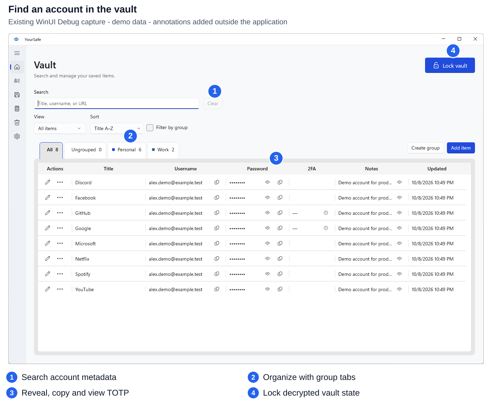

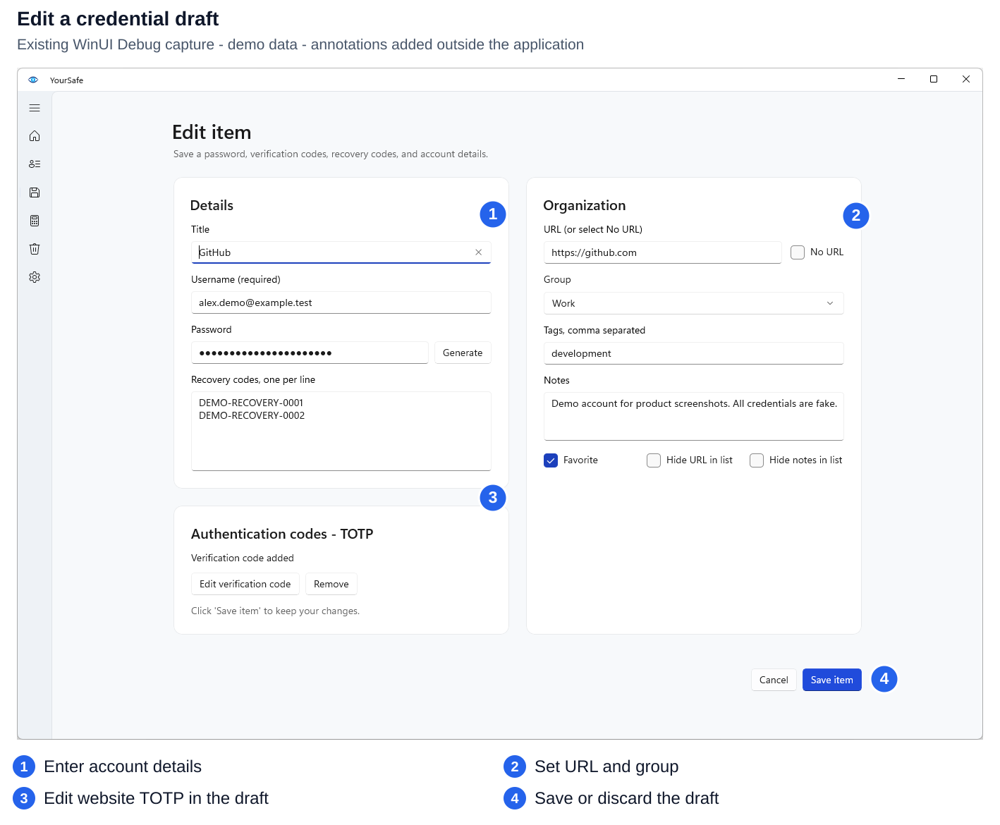

These are historical native WinUI Debug captures with synthetic demo data, not fresh UI/release qualification. Their embedded PNG pixels and aspect ratios are preserved. An older editor capture can show controls such as Tags that no longer represent the current data contract; legacy Tags fields are now ignored. Use the current source-backed flows above for behavior.

Source PNGs: [vault](../../website/assets/homepage/desktop-vault.png), [editor](../../website/assets/homepage/desktop-editor.png). [Asset provenance](../../website/assets/PROVENANCE.md) records their origin; each screenshot SVG embeds its source path/digest. UI source: [MainPage.xaml](../../src/PasswordTool.WinUI/MainPage.xaml), [MainPage.xaml.cs](../../src/PasswordTool.WinUI/MainPage.xaml.cs).

## Editing and regeneration

The **20 Mermaid files** are the semantic sources. Their SVGs are generated with **Pretty Mermaid / beautiful-mermaid 1.1.3**, using the `github-light` palette with stronger connector/secondary-text contrast and the local Segoe UI font. The two annotated screenshot SVGs are separate editable assets and are not regenerated from Mermaid.

With the `pretty-mermaid` Codex skill and its dependencies installed locally, run from the repository root:

```powershell
node scripts/Render-Diagrams.mjs
# If the skill is installed elsewhere, supply its directory:
node scripts/Render-Diagrams.mjs C:\path\to\pretty-mermaid
```

The [renderer wrapper](../../scripts/Render-Diagrams.mjs) invokes the skill's bundled batch CLI. It renders and checks the complete collection before replacing diagram outputs, then adds accessible metadata, a visible heading and the source digest. It strips accessibility directives from temporary renderer input because this renderer version otherwise treats them as nodes; the original directives are preserved in each source and attached to the SVG root. It removes Google Fonts imports so exported SVGs need no network font request. No renderer dependency is added to the application.

The older [theme.json](theme.json) is retained for conventional Mermaid tooling; the Pretty Mermaid exports use their own named theme. Edit sources, run the wrapper, check the diff, then inspect full-size SVGs and documentation-width previews. Keep text readable by splitting concerns or shortening labels. When changing a flow, verify success, rejection, cancellation, expiry and rollback semantics against its linked code. Do not hand-edit generated SVGs or make security guarantees absent from source.

Scope limits: source review and diagram rendering do not establish runtime security, signing, browser-store qualification or successful recovery of a real user vault.
