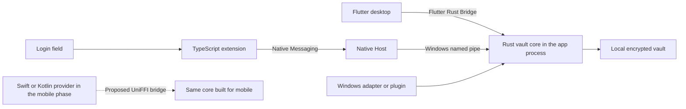

# YourSafe Rewrite Plan · Windows Desktop First

Feature inventory as of November 19, 2026, at YourSafe commit `12acdf7`. This plan covers YourSafe's current features, Password Bunny features for reference, the proposed architecture, and release milestones. The recommended first release uses **Flutter/Dart for the Windows app, a shared Rust core, and TypeScript for the Chromium extension**. The vault stays on the device. The interface makes it easy to find, unlock, fill, and recover accounts with clear layouts, keyboard support, readable status messages, and light motion where it helps provide feedback.

## 1. Current YourSafe features

The inventory reflects the code and documentation reviewed for this plan. Individual workflows have yet to be rerun. Use the `YS` IDs to track the port. Feature parity means preserving the behavior and data users rely on while allowing screens and controls to be redesigned.

| ID | Area | Current behavior |
| --- | --- | --- |
| YS-01 | Getting started | Detects a fresh installation, an existing vault, or a vault file pair with one file missing. The setup wizard requires a Master Password of at least 12 characters, sets up the Authenticator using a QR code or setup key, verifies a six-digit TOTP code, and asks the user to confirm they saved the Recovery Key before committing. Restoring a backup is a separate path. |
| YS-02 | Sign-in | Checks the Master Password before showing the TOTP step and starts a session only after both checks pass. The sign-in session lasts five hours from sign-in. Reopening the vault within that session requires the Master Password. Expiry, sign-out, and app restart require full sign-in. |
| YS-03 | Locking | Offers manual locking and a timer that starts when the vault opens. The default is one minute, with choices of 1/2/5/10/30/60/120/300 minutes, capped by the five-hour session. Activity does not extend either deadline. Locking the vault table clears the key and decrypted contents and may leave visible metadata in place. Some desktop actions use the Master Password to unlock temporarily and then relock. Windows lock, disconnect, suspend, and resume also clear workspace metadata and editor state and cancel pending actions. |
| YS-04 | Vault items | Stores title, username, password, URL or No URL, notes, favorite status, group, and update time. A single item can contain a password, website TOTP, and recovery codes. Legacy recovery-code-only items and imported TOTP-only items are supported. The desktop editor currently requires a title, username, password, and either a URL or No URL. A recovery code list must contain at least two distinct codes. |
| YS-05 | Organization | Searches locally by title, username, or visible URL. Filters include All, Favorites, Passwords, Recovery codes, and group. Sorts by title or update time in either direction. Users can create, rename, or recolor groups, move or unassign items, see item counts, and use horizontal or vertical tabs. Deleting a group requires a confirmation phrase and also deletes its items in Trash. Earlier backups or snapshots may still contain those items. All is an aggregate filter. |
| YS-06 | Editor and secret access | Adds, edits, and shows item details. Reveal, mask, and copy actions for usernames, passwords, notes, and recovery codes depend on the action and current authorization. Hidden URLs and notes show a Hidden label and are omitted from the corresponding search or display. Draft changes become permanent when saved and are discarded on cancellation. The app makes a best-effort attempt to clear sensitive clipboard data after 30 seconds or on lock, provided the clipboard still contains the value YourSafe wrote. |
| YS-07 | Website TOTP | Accepts Base32 or an `otpauth://totp/` link. Supports issuer and account, SHA-1/SHA-256/SHA-512, six or eight digits, and a custom period. The live code panel shows a countdown and closes on lock. Copy generates the current code again. Website TOTP is separate from the Authenticator used to sign in to YourSafe. |
| YS-08 | Generator | Generates random passwords and passphrases with configurable options and strength feedback. A generated secret enters the vault only when the user saves the item. |
| YS-09 | Security Check | Checks offline for weak passwords, exact reuse, and passwords at least 365 days old. Results contain no secrets and lead to the relevant editor. Editing notes or a group does not reset password age. Older records have a fallback for deriving the password change date. |
| YS-10 | History and Trash | Retains up to 10 previous passwords in encrypted storage. Supports soft deletion, viewing Trash, restoring items, and permanent deletion. Items expire from Trash after 30 days. Deleting from the active vault leaves earlier backup and snapshot copies intact. |
| YS-11 | Settings | System/Light/Dark themes, group tab orientation, backup status, and browser integration opt-in for the app session. Changing the unlock duration requires the Master Password and takes effect after restarting the app. Settings also support changing the Master Password, upgrading a legacy KDF as needed, replacing the Authenticator after verifying its new code, and rotating the Recovery Key after authentication. |
| YS-12 | Recovery Key | Supports enrollment for older vaults after authentication. The current Recovery Key can reset the Master Password and Authenticator. The user must confirm the new key and verify the new Authenticator before the app writes changes. Vault contents remain intact, and the user signs in again. Rotation leaves the keys and credentials in older snapshots intact. |
| YS-13 | External backup | Exports a `PasswordToolBackup` v1 envelope using a separate passphrase of at least 12 characters. Authenticated verification returns metadata and item counts only. Tracks the last successful export and verification, with a reminder if no backup exists or it is more than 30 days old. Preserves item data, TOTP, recovery codes, history, Trash, and favorites. The v1 format omits group definitions, appearance, the sign-in Authenticator, and old sign-in keys and configuration. |
| YS-14 | Restore on a new machine | Runs only when both `.config` and `.storage` are absent. Authenticates the backup, previews the item count, and creates a new Master Password, Authenticator, Recovery Key, and vault key before committing. A vault Recovery Key does not decrypt a backup file. |
| YS-15 | Import into an existing vault | Validates the entire encrypted backup, previews new, duplicate, and conflicting items, and adds only new IDs. Bounded plaintext CSV import from browsers and password managers previews new and duplicate items, preserves supported TOTP configuration, and adds only new items. The README warns about plaintext CSV exports from other apps. The source review found no YourSafe CSV export entry point. |
| YS-16 | Snapshots and persistence | Retains up to five prior configuration and storage pairs. Restore validates the pair, requires the current Master Password and the snapshot's password if different, and ends the sign-in session. Paired writes use staging, verification, a journal, and rollback. Startup can complete an interrupted transaction. Snapshots provide rollback on the same disk. |
| YS-17 | Data protection | Uses AES-256-GCM with a random 256-bit data encryption key (DEK). Argon2id derives a wrapping key from the Master Password, and the Recovery Key has its own slot. Backup v1 uses PBKDF2-SHA256 with 600,000 iterations and AES-256-GCM. Sign-in TOTP authorizes access at the app layer and plays no role in key derivation. Supports legacy configuration and group data. The `.trusted-unlock` file and Windows DPAPI path are retained for compatibility. Current WinUI sign-in requires the Master Password. |
| YS-18 | Browser discovery | Supports Chrome, Edge, and Brave according to release configuration. The popup depends on app status, integration being on, and the vault being normally unlocked. Returns only the ID, title, username, and password/TOTP flags for an exact origin match. Hidden, missing, or invalid URLs are excluded. Discovery is bounded and expires. |
| YS-19 | Browser fill | The user selects an account in the popup and approves the action once on desktop. The extension finds eligible fields and checks the tab, frame, document, origin, form, and field visibility before filling the username and password. The user submits the form. Pending approval is surfaced in the UI, taskbar, and Windows notifications as needed. Reopening the popup can resume the in-flight action within its deadline. A changed target, expiry, lock, or integration being turned off cancels the request. |
| YS-20 | Browser TOTP | View and Copy require separate approvals. View shows a single code and its validity window without requesting a new code automatically. Copy generates the current code and writes it to the desktop clipboard. The popup offers Open YourSafe, refresh, and cancel, with status or errors for the app being unavailable, integration off, the vault locked, no match, a pending request, or a protocol mismatch. |
| YS-21 | Hash Tool | Generates, verifies, and identifies password hashes. Supports Argon2id, bcrypt, PBKDF2-SHA256/SHA512, scrypt, and ASP.NET Core Identity. Fast hashes such as MD5 and SHA variants are educational. The tool is separate from the vault's reversible encryption. |
| YS-22 | Development API | Provides hash, verify, inspect, and algorithm listing over loopback, with request size, rate, and concurrency limits. Responses are not cached. The optional API has no vault operations and is excluded from the desktop installer. |
| YS-23 | Installation and release | Per-user Windows x64 installer and portable ZIP. Upgrading or uninstalling preserves vault data. Portable runs against the current Windows profile. Native Messaging registers the configured store IDs. The ZIP does not write to the Registry automatically. Updates are manual. Releases include checksums and signing status, and the default workflow publishes unsigned evaluation artifacts. |
| YS-24 | Website and demo | Vietnamese and English landing pages, instructions, and privacy policies, with links to the release and extension. The local sign-in demo uses sample data and can be used to try fill. The site's GA4 configuration is separate from the desktop vault and extension. |

Sources: [README](../README.vi.md), [architecture and invariants](architecture.md), [workflow diagrams](diagrams/README.md), [extension](../browser-extension/README.md), [API](../src/PasswordTool.Api/README.md), [release operations](release-operations.md), and [website](../website/README.md). Code references: [AppFlowCoordinator](../src/PasswordTool.Presentation/AppFlowCoordinator.cs), [VaultWorkspaceViewModel](../src/PasswordTool.Presentation/VaultWorkspaceViewModel.cs), [SettingsViewModel](../src/PasswordTool.Presentation/SettingsViewModel.cs), and [VaultStorageService](../src/PasswordTool.Core/Services/VaultStorageService.cs).

## 2. Password Bunny feature reference

This inventory draws from the product page, Windows MSIX `1.1.6.44`, and Chrome CRX `1.1.6.43`. **Code** refers to JavaScript or release configuration inspected directly. **Binary evidence** refers to schemas, exports, symbols, or screen names embedded in the package. **Published** refers to vendor statements. Binary evidence shows that a feature is represented or has implementation components. Its default settings, cross-platform availability, and native runtime behavior may still need verification.

| ID | Bunny feature | Evidence and relevance to YourSafe |
| --- | --- | --- |
| PB-01 | Suggestions beside the input field, filtering as the user types a username, keyboard controls, and screen reader support | **Code.** Prioritize after the basic desktop port. Keep the popup as a fallback. |
| PB-02 | Multi-step login detection, identifier remembered by tab and site, separate handling for login, sign-up, and password changes, and conditional support for dynamic forms, Shadow DOM, and frames | **Code.** Start with standard top-level forms. Add multi-step support for proven use cases and verify the permitted target scope for each expansion. |
| PB-03 | Bunny Lens lets users identify a username, current or new password, OTP, submit control, or field to ignore. Uses selectors scoped by site and path, supports undo/reset, and detects rules that no longer match. | **Code and binary evidence.** A small YourSafe version could cover username/password, require a unique selector, and revalidate at fill time. Rule data describes field locations only. |
| PB-04 | Suggests saving or updating an account during sign-in, registration, or password changes. Detects duplicates, can link a URL to an existing entry, and remembers dismissals. | **Code and binary evidence.** Browser events and heuristics estimate login state, so success cannot always be confirmed. Schedule after inline fill, with a preview and explicit approval before writing. |
| PB-05 | Password generator on the form, based on field hints, with character group options and generation history | **Code and binary evidence.** Offer generation at the point of use. Evaluate generation history separately because it retains additional secrets. |
| PB-06 | Website OTP and fill into one field or several digit fields. Shows the code and time remaining. Evidence also points to QR scanning and saving TOTP to an item. | **Code and binary evidence.** Preserve View and Copy first. Direct OTP fill and QR scanning are separate improvements. |
| PB-07 | Extension passkeys with prepare, select, commit, and cancel steps. Windows declares a passkey provider. Account linking and usage history are also represented. | **Code, binary evidence, and published.** Track separately to validate the key lifecycle and OS/browser integration. |
| PB-08 | Extension/app connection states for pending approval, denied, canceled, and expired. Origin/browser rules and revocable grants for a single use, a time limit, a session, or longer-term access. | **Code and binary evidence.** Learn from the status UI. Bunny's default permissions and scope are unverified. The Chromium package inspected uses loopback HTTP. YourSafe keeps Native Messaging. |
| PB-09 | Per-site opt-in/opt-out, locked-state banner, opening the app and resuming a valid flow, popup, and extension update checks | **Code.** Make the locked state and path back clear. Revalidate the destination when resuming and require a selection for new requests. |
| PB-10 | Local offline vault, setup or restore on first launch, a setup checklist, autofill setup and demo, Master Password changes and check reminders, and lifecycle-based locking | **Binary evidence and published.** Use onboarding and the backup checklist as references. Bunny publishes Argon2id/XChaCha20-Poly1305. The binary contains related libraries and SQLCipher, but the algorithms used on every storage path are unverified. |
| PB-11 | Unlock with biometrics or the device lock, enroll or disable device unlock, Windows Hello, and a privacy cover on mobile | **Binary evidence and published.** Evaluate Windows Hello after desktop stabilizes and keep the existing sign-in rules until a separate decision. Bunny's FAQ points users to an enrolled device that can still unlock and export the vault. The reviewed evidence did not establish an equivalent to YourSafe's Recovery Key. |
| PB-12 | Item summaries, search/filter/sort/pagination, favorites, tags, editor, multiple credential types per item, and moving credentials between items | **Binary evidence.** Use the list structure as a reference and keep existing groups first. Other types represented include secure notes, cards, identities and contacts, crypto wallets, API/SSH keys, Wi-Fi, and files. The presence of a data type does not establish that its UI is complete. |
| PB-13 | Record history with revisions, field changes, writing device, and review/restore, plus Trash, bulk actions, and purge | **Binary evidence.** Preserve the current password history and Trash first. Add full revisions and bulk actions if needed. |
| PB-14 | Reuse and breach checks, with skipped/failed states and per-item opt-out, plus a public breach checker on the website | **Binary evidence and published.** Keep YourSafe's offline checks. Evaluate an online breach service once its data flow and opt-in policy are clear. |
| PB-15 | Two-step Analyze/Apply import with previews, warnings, item/credential/rule selection, merge handling, and file fingerprints | **Binary evidence and published.** Sources identified include 1Password, Enpass, Bitwarden, Chrome, Bunny, Apple Passwords, Proton Pass, LastPass, and NordPass, with CSV, JSON, or Bunny archive formats depending on the source. Preserve the existing no-overwrite behavior first and add readers as needed. |
| PB-16 | Passphrase-protected archive with record, credential, and site rule selection. Automatic and manual snapshots, health status, additive or replacement restore, and snapshot rewrapping status. | **Binary evidence.** Learn from how recovery options are explained. Design and verify replacement restore separately before adding it. |
| PB-17 | Sync to user-selected storage such as Google Drive, OneDrive, Dropbox, iCloud, WebDAV, or NAS as advertised. Represents device status, the key lifecycle, record and field conflicts, and keeping local, remote, or both versions. | **Binary evidence and published.** A longer-term reference. Start Windows with manual encrypted backup and defer sync. |
| PB-18 | Attachments with upload/download status, progress, and cancellation. Evidence of syncing audit data, breach results, and attachments. | **Binary evidence.** Defer because attachments increase the storage surface, traffic, and risk of data loss. |
| PB-19 | Audit logs and export, debug logs, CXP/CXF credential exchange, platform-specific exchange integrations, and rules or grants for agents and extensions | **Binary evidence.** Keep for reference if needed later. Out of scope for the first desktop release. |
| PB-20 | Desktop tray and sync, opening the app by deep link, opt-in Windows startup, update checks and downloads, release notes, notifications, and open-source license listings | **Binary evidence and manifest.** Prioritize signed installation and upgrades and user support. Tray and automatic updates are separate work. |
| PB-21 | Windows, macOS, iOS, Android, and Chrome, with Safari evidence, different desktop/mobile layouts, and localization | **Published and binary evidence.** Feature parity across platforms is unverified. YourSafe mobile follows the Windows milestones. |
| PB-22 | Trial, subscription and lifetime plans, continued read and export access after expiry according to the product site, plus announcements, a mascot, and seasonal effects | **Published and UI evidence.** Product reference only. YourSafe desktop prioritizes the vault, recovery, and autofill. |

Sources: [Password Bunny product page](https://passwordbunny.ai/en#features), [Chrome Web Store](https://chromewebstore.google.com/detail/eopkmgfhbeiejmibnpiemofbnnnmaman), [feature analysis notes](../.tmp/bunny-static-review/FEATURES.vi.md), and [desktop package notes](../.tmp/bunny-static-review/REVIEW.vi.md). Both technical notes are in the local `.tmp` directory and may be absent from another checkout. The table records the relevant findings. The actual Bunny Windows download is approximately **73.17 MB**, plus dependencies if needed. The roughly 1 KB `.appinstaller` is installation metadata. Base the stack decision on porting effort, lifecycle behavior, and measurements. [Microsoft App Installer](https://learn.microsoft.com/en-us/windows/msix/app-installer/app-installer-file-overview).

## 3. Target architecture

Assume one user per device, one desktop app session owning the vault, and multiple browser tabs that can request autofill. Divide responsibilities by where the work runs and where secrets live. The first Windows release stays on `x64`, with a core that can be built separately for mobile.



| Proposed module | Responsibilities and authority |
| --- | --- |
| `rewrite/crates/vault-core` | Owns vault rules, key derivation and encryption, key slots, formats, recovery, import, sessions, secret authorization, and save transactions. Offers a small command API for actions such as unlock, lock, list summaries, save, backup, and authorize fill. Split modules by function and add adapters when an integration requires one. |
| `rewrite/apps/desktop` | Flutter and the Dart bindings to Rust through `flutter_rust_bridge`. Organize by vault, editor, security, recovery, and settings. The UI owns display state and local drafts and receives secrets only for operations that need to show or edit them. Rust runs KDF, file I/O, and parsing off the UI thread. |
| Windows adapter within the desktop app | Handles the OS session lifecycle, clipboard, paths, single-instance lock, focus and notifications, named pipe API, and peer verification. Use a separate Windows crate if the implementation warrants it. Windows Hello comes later. |
| `browser-extension/` and Native Host | Reuse the TypeScript code and types, contract fixtures, origin/document/form checks, and popup. The host is a small relay. Retain `PasswordTool.NativeHost` initially if the v3 contract and peer verification remain compatible. Replace it when measurements or protocol changes justify it. |
| Android/iOS after desktop | Flutter reuses the relevant vault management UI and the core. The proposed UniFFI bridge lets the Kotlin or Swift provider call the core when Flutter's UI is closed. Platform adapters use Keystore or Keychain. Test packaging, OS-approved data sharing, write coordination, and authorization with the provider in a separate process. |

Common vault and backup formats make data transfer across platforms possible. Each device keeps a local copy and its own session. Encrypted backup files can be transferred before deciding whether to add sync. [Flutter supported platforms](https://docs.flutter.dev/reference/supported-platforms), [Flutter Rust Bridge](https://cjycode.com/flutter_rust_bridge/guides/cross-platform/overview), [UniFFI](https://mozilla.github.io/uniffi-rs/latest/), [Android Autofill](https://developer.android.com/identity/autofill/autofill-services), and [Apple Credential Provider](https://developer.apple.com/documentation/authenticationservices/ascredentialproviderviewcontroller).

**Desktop integration.** The worker uses browser-supplied context, validates messages at runtime, and sends requests through Native Messaging to the relay, then via a named pipe to the app. One component owns vault state. At each secret read, check that authorization still covers the item, action, origin, and session. The worker also binds the request to the tab, frame, and document and checks them before delivery and before writing to the field. The desktop receives the origin as a client-supplied claim. The extension uses browser context to verify the actual destination. Suggestions contain metadata only. Fill returns the minimum secret needed and avoids logging or caching it. [Chrome Native Messaging](https://developer.chrome.com/docs/extensions/develop/concepts/native-messaging), [`WireProtocol.cs`](../src/PasswordTool.Presentation/Autofill/WireProtocol.cs), [`worker.ts`](../browser-extension/src/worker.ts), and [`fields.ts`](../browser-extension/src/fields.ts).

**Inline fill.** Start with optional, per-site permissions on eligible top-level pages. Keep the current TypeScript settings. Validate `unknown` input, distinguish locked/off/pending/ready/error results, and discard stale results when focus or the document changes. Put the menu in extension-owned UI and verify the source and window if using an iframe bridge. Bound scans to the form, avoid page-wide polling, support keyboard and pointer controls, and leave submission to the user. Keep per-action desktop approval initially. Improve the return to the original tab after unlocking. Reducing approval prompts requires a separate decision that defines scope, expiry, and revocation.

**Compatibility.** Use **v1 backup import into a new vault** as the initial transfer path. It works through an encrypted file and leaves the original vault available for rollback. The preview must explain that the backup omits group definitions and old settings. If an upgrade needs to preserve the vault, groups, history, and Recovery Key, verify a separate authenticated migration from the v4 file pair. Read a synthetic copy in read-only mode before writing to the destination vault. During the pilot, the new app uses a separate storage namespace. The two apps must never point to the same vault. Before replacing the old release, either demonstrate full data preservation through migration or make an explicit product decision to use backup transfer with its limitations clearly disclosed. Use fixtures and C# behavior as the reference. Give any format, KDF, or recovery change its own decision, maintained libraries, and test vectors. Failures and cancellations before commit must leave the source unchanged. Authorize one writer at a time and ensure restart after an interruption can identify the correct valid state.

| Scenario | Design and verification requirements |
| --- | --- |
| A vault or backup file is copied or altered | Protect secrets with authenticated encryption and validate versions and parameter limits before expensive work. A damaged file or incorrect key returns a clear error and leaves the source intact. Sign-in TOTP gates the app and does not add protection to a copied vault file. |
| A tab, web page, extension message, or IPC peer supplies untrusted data | Bound sizes, deadlines, and pending requests. Verify payload shape, peer identity, and context. Enforce authorization at the final read or write. An approved selection is single-use and expires when its context changes. |
| The app locks or closes while an operation is running | Revoke the session, discard stale results, clear secret copies where the runtime allows, and check authorization at the point of delivery. Define memory ownership at the bridge and contain panics and exceptions on their side of the boundary. |
| A write fails, power is lost, or two processes want to write | Give the vault one owner, check state before committing, keep a recoverable encrypted copy, and test reopening after failure at each step. Debug output contains only diagnostic error codes and status. |

## 4. Roadmap and acceptance criteria

| Milestone | Scope | Acceptance criteria |
| --- | --- | --- |
| **M0 · Windows prototype** | Minimal Rust core, Flutter bridge, a synthetic v1 backup fixture, an unlock → metadata list → lock flow, and a Native Messaging/pipe proof that returns no secrets. | Run a Windows x64 release build. Read the valid C# fixture and reject an incorrect passphrase or altered file. Keep plaintext out of disk files and logs. Lock revokes access. Verify closing and reopening the UI and build once in a clean Windows environment. Record download/installation size, cold startup, background RAM, and unlock time as a baseline. |
| **M1 · Desktop vault** | Address YS-01–YS-17 at current behavioral parity. Start with creating, reading, editing, searching, locking, and recovery. Complete Security Check, groups, history/Trash, import, settings, and backup before a replacement beta. | Exercise sign-in and re-unlock, deadlines, sleep and lock, cancellation during decryption, clipboard, key changes, and restore. Compare old and new fixtures, password age, TOTP, group moves, limits, and duplicate handling. Inject write failures at each step and test restart after interruption. |
| **M2 · Browser parity** | Address YS-18–YS-20. Reuse popup, wire contract, and native relay where they pass verification. Use the correct store ID and registration for each supported browser when releasing. | Run real end-to-end tests with Chromium and a test profile. Cover app closed, locked, or integration off, changing tabs/documents or locking while a request is pending, repeated clicks, cancellation, reopening the popup, hidden or changed form fields, expired OTP, and version mismatch. Verify the popup and browser logs retain no secrets or expired codes. |
| **M3 · Windows release** | Address YS-23 and update YS-24 when release artifacts exist. Keep the existing Hash Tool and API as separate repo utilities initially. Decide separately whether the new UI needs Hash Tool parity. Keep the development API out of the installer. | Verify install, upgrade, uninstall, and portable use on clean Windows, signature and checksum, data preservation or rollback, and compatible app/host/extension versions. Document recovery for each scenario. Import a v1 backup into the new app and verify recovery within its disclosed scope. Compare results against the C# release on the same machine and fixture. |
| **M4 · Bunny-inspired desktop improvements** | PB-01 and PB-09 first: field-level suggestions and locked-state handling with a return path. PB-02 adds multi-step forms. PB-04 and PB-05 add save/update and contextual generation. PB-03 adds a minimal Lens when a real site cannot be detected. PB-06 adds direct OTP fill if needed. | Test keyboard use, avoid misclassifying search and registration fields, send no secrets during discovery, prevent fills into a different document, and preserve data during save/update. Measure focus-to-menu and selection-to-fill separately from the time users spend approving. |
| **M5 · Mobile** | Build one native autofill workflow using synthetic data on Android and iOS with the shared core. Then build mobile management screens and decide on new credential types, passkeys, and sync. | The OS can invoke the provider with the main UI closed. The provider uses the correct app or site, session, and lifecycle state, with coordinated writes. Verify on physical devices and validate iOS signing and packaging through macOS/Xcode. |

The order reflects value and dependencies. Release dates remain open. M0 through M3 establish a Windows replacement. If measuring inline UX earlier would help, run a pilot on fixtures once M2 has a reliable fill path and apply the same security criteria.

## 5. Review before implementation

The rewrite changes the app platform and preserves the behavior of a local vault. The expected workload is one personal vault with multiple browser tabs and Windows lifecycle events that can interrupt browser operations.

1. **Resolve before transferring real data.** A v1 backup can restore passwords while losing the user's group definitions. Preview the transfer scope, keep the original vault, and verify parity with a fixture containing groups, favorites, Trash, history, and TOTP. If groups must survive, verify v4 migration separately before presenting the new app as a replacement upgrade.
2. **Resolve before releasing secrets.** A request awaiting approval can finish after the vault locks or the page changes. Invalidate it when the session lifecycle or destination changes and check again at both secret release and field fill. Verify this in end-to-end tests with an actual pending request.
3. **Resolve before the Windows release.** A partial upgrade can leave the app, pipe protocol, and relay on incompatible versions. Use the current contract fixtures, show an explicit compatibility error, qualify the package, and test install, upgrade, and uninstall with a synthetic profile.
4. **Measure before optimizing.** Benchmark KDF time, Flutter startup, memory across the two processes, and the number of user interactions separately. Set targets after establishing the baseline and keep the KDF strength during benchmarking. Defer replacing the relay or adding a database solely to hit a size target.

Begin with M0. Items 1–3 are conditions for moving from pilot to release. Runtime behavior remains to be verified.

## 6. Implementation prompt for M0

```text
Objective
Implement M0 in docs/yoursafe-rewrite-plan.en.md. Demonstrate that Flutter on
Windows can call the Rust core, open a v1 backup created from synthetic data
by the C# implementation, and exchange status through Native Messaging and
a Windows named pipe.

Context
Read README.vi.md, docs/architecture.md, docs/diagrams/README.md,
docs/release-operations.md, browser-extension/README.md, and the relevant
Core and Presentation code before making changes. Use the C# implementation
as the reference for the file format and product behavior.

Scope
Build an isolated prototype under rewrite/. Use Flutter/Dart, a UI-independent
Rust core, and Dart bindings through flutter_rust_bridge. Generate a synthetic
encrypted backup fixture using C# and verify Rust reads the expected data.
Display a few metadata rows on desktop, unlock and lock through the core, and
let the browser read status through a verified contract. Keep one writer for
the test vault. Give the test data, installer, and native host separate names
from their production counterparts.

Constraints
Use synthetic data only. Do not access a real vault, overwrite the old vault,
or deploy publicly. Preserve v1 encryption compatibility, authenticate the
backup before returning decrypted contents to the UI, enforce input/KDF bounds,
and keep secrets out of logs. The M0 browser path only reads status. Keep
TypeScript strict and validate unknown inputs, protocol version, request ID,
peer identity, and lifecycle state at the boundary. Defer the remaining
features, mobile, Windows Hello, passkeys, sync, and inline fill. Keep this
prototype free of a new database or server.

Acceptance and handoff
Test the valid fixture, incorrect passphrase, tampering, and oversized files.
Verify that the list and status contain no secrets. Test lock, disconnect,
parsing, and protocol mismatch. Try a Windows x64 release build and a live
connection with a test Chromium profile. Report commands, results, and anything
still unverified. Compare cold start, unlock time, background RAM, and size with
C# on the same machine and fixture. If tools block part of the work, identify
the exact step and complete the checks that can run. Record whether M0 passed
before recommending M1.
```

The current threat model still applies. Encryption protects copies of data at rest. The destination page can read data entered into its fields. Clipboard cleanup is best effort. Malware already running in the user's Windows session remains outside the protection the app can guarantee. The Bunny inventory reflects the available sources and leaves cross-version and cross-device behavior unverified. The proposed bridge, migration, and native provider need testing before committing to a release.
