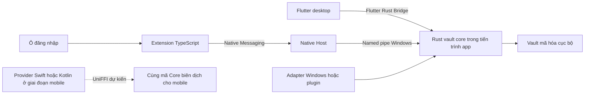

# Kế hoạch làm lại YourSafe · Windows desktop trước

Mốc kiểm kê: 19/11/2026, repo YourSafe tại `12acdf7`. Tài liệu này gồm danh mục tính năng hiện có, danh mục tham khảo Password Bunny, kiến trúc đích và các mốc nghiệm thu. Quyết định đề xuất cho bản đầu là **app Windows Flutter/Dart, Core Rust dùng chung, extension Chromium TypeScript**. Vault tiếp tục nằm trên thiết bị. Giao diện ưu tiên tìm, mở, điền và khôi phục tài khoản với ít thao tác; dùng bố cục rõ, hỗ trợ bàn phím, trạng thái dễ hiểu và chuyển động nhẹ khi cần phản hồi.

## 1. Kiểm kê YourSafe hiện tại

Đây là hành vi đối chiếu từ mã và tài liệu, không phải kết quả chạy lại từng luồng. Các mã `YS` dùng để theo dõi khi port. “Ngang tính năng” nghĩa là giữ hành vi và dữ liệu người dùng dựa vào, cho phép thiết kế lại màn hình và vị trí thao tác.

| Mã | Nhóm | Hành vi hiện có |
| --- | --- | --- |
| YS-01 | Bắt đầu | Phát hiện kho mới, kho hiện có hoặc cặp tệp thiếu một nửa. Wizard tạo kho đặt Master Password tối thiểu 12 ký tự, cấu hình Authenticator bằng QR/mã thiết lập, kiểm tra TOTP sáu số và xác nhận lưu Recovery Key trước khi commit. Có nhánh khôi phục backup riêng. |
| YS-02 | Đăng nhập | Kiểm tra Master Password trước khi hiện bước TOTP; chỉ cấp phiên sau khi qua cả hai bước. Phiên đăng nhập cố định 5 giờ. Mở lại trong phiên bằng Master Password; hết hạn, đăng xuất hoặc khởi động lại thì đăng nhập đầy đủ. |
| YS-03 | Khóa | Nút khóa và bộ đếm từ thời điểm mở vault, mặc định 1 phút, lựa chọn 1/2/5/10/30/60/120/300 phút, giới hạn bởi phiên 5 giờ; hoạt động không gia hạn. Khóa bảng bỏ khóa và nội dung giải mã, có thể giữ metadata hiển thị. Một số thao tác desktop mở tạm bằng Master Password rồi tự khóa lại. Windows lock/disconnect/suspend/resume xóa thêm metadata, editor và thao tác đang chờ. |
| YS-04 | Mô hình mục | Tên mục, username, mật khẩu, URL hoặc No URL, notes, yêu thích, nhóm, thời gian cập nhật. Mật khẩu, TOTP website và mã khôi phục có thể cùng nằm trong một mục; hỗ trợ mục cũ chỉ có recovery codes và mục TOTP-only từ import. Editor desktop hiện yêu cầu title, username, password và URL hoặc No URL. Mã khôi phục khác nhau tối thiểu hai mã khi có danh sách. |
| YS-05 | Tổ chức | Tìm cục bộ theo tên/username/URL hiển thị; lọc All, Favorites, Passwords, Recovery codes và theo nhóm; sắp xếp tên hai chiều hoặc thời gian cập nhật hai chiều. Tạo/đổi tên/đổi màu nhóm, chuyển mục giữa nhóm, bỏ gán nhóm, đếm mục, tab ngang/dọc. Xóa nhóm có xác nhận bằng cụm từ và xóa cả mục trong Trash thuộc nhóm; bản sao đã tạo trước đó vẫn có thể chứa chúng. All là bộ lọc tổng hợp. |
| YS-06 | Editor và đọc bí mật | Thêm, sửa, xem chi tiết, hiện/che, sao chép username/mật khẩu/notes/recovery codes theo thao tác và quyền hiện tại. URL/notes ẩn hiển thị trạng thái Hidden và không đi vào phần tìm kiếm/hiển thị tương ứng. Draft giữ thay đổi đến khi lưu; hủy bỏ draft. Giá trị nhạy cảm được dọn khỏi clipboard theo khả năng sau 30 giây hoặc khi khóa, chỉ khi còn đúng nội dung do YourSafe ghi. |
| YS-07 | TOTP website | Nhập Base32 hoặc liên kết `otpauth://totp/`; issuer/account, SHA-1/SHA-256/SHA-512, 6/8 số và chu kỳ tùy chỉnh. Panel mã theo thời gian, có đếm ngược, đóng khi khóa; copy tạo lại mã hiện hành. TOTP này độc lập với Authenticator dùng đăng nhập YourSafe. |
| YS-08 | Generator | Mật khẩu ngẫu nhiên và passphrase, tùy chọn cấu hình và phản hồi độ mạnh; bí mật đã sinh chỉ đi vào vault khi người dùng lưu mục. |
| YS-09 | Security Check | Quét offline mật khẩu yếu, trùng chính xác và từ 365 ngày tuổi; kết quả không chứa bí mật và dẫn đến editor của mục tương ứng. Sửa notes/nhóm không làm mới tuổi mật khẩu; dữ liệu cũ có cách suy ra ngày đổi mật khẩu. |
| YS-10 | Lịch sử và Trash | Giữ tối đa 10 mật khẩu trước đó trong dữ liệu mã hóa. Soft delete, xem Trash, khôi phục hoặc xóa vĩnh viễn; mục hết hạn sau 30 ngày được dọn. Không coi xóa trong vault đang dùng là xóa khỏi snapshot/backup cũ. |
| YS-11 | Settings | Theme System/Light/Dark, hướng tab nhóm, trạng thái backup, opt-in browser theo phiên app. Đổi thời gian mở kho cần Master Password và áp dụng sau khi mở lại app. Đổi Master Password, nâng KDF cũ khi cần, thay Authenticator sau khi xác minh mã mới, xoay Recovery Key sau khi xác thực. |
| YS-12 | Recovery Key | Enrollment cho kho cũ sau khi xác thực; reset Master Password và Authenticator khi còn Recovery Key hiện tại. Phải xác nhận key mới và Authenticator mới trước khi ghi. Giữ nội dung vault, kết thúc phiên và yêu cầu đăng nhập lại. Rotation không sửa khóa/thông tin xác thực trong snapshot cũ. |
| YS-13 | Backup ngoài | Xuất envelope `PasswordToolBackup` v1 bằng passphrase riêng tối thiểu 12 ký tự. Xác minh có xác thực, chỉ trả metadata và số mục. Theo dõi lần xuất và lần xác minh thành công; nhắc khi chưa có hoặc đã quá 30 ngày. Bảo toàn dữ liệu mục, TOTP, mã khôi phục, lịch sử, Trash và favorites; backup v1 không giữ định nghĩa nhóm, giao diện, Authenticator đăng nhập hoặc các khóa/config đăng nhập cũ. |
| YS-14 | Khôi phục máy mới | Chỉ chạy khi cả `.config` lẫn `.storage` đều chưa tồn tại. Xác thực backup, xem số mục, tạo Master Password, Authenticator, Recovery Key và khóa vault mới rồi commit. Recovery Key của vault không giải mã file backup. |
| YS-15 | Import vào kho đang dùng | Backup mã hóa được kiểm tra toàn bộ, xem trước mục mới/trùng/xung đột, thêm ID mới. CSV plaintext từ browser/manager có giới hạn, xem trước mới/trùng, giữ cấu hình TOTP hỗ trợ, chỉ thêm mục mới. README cảnh báo về CSV xuất từ ứng dụng khác; chưa thấy entry point xuất CSV của YourSafe trong mã đã đối chiếu. |
| YS-16 | Snapshot và ghi dữ liệu | Giữ tối đa năm cặp config/storage trước đó. Restore kiểm tra cặp, yêu cầu Master Password hiện tại và của snapshot nếu khác, rồi kết thúc đăng nhập. Ghi theo cặp dùng staging, xác minh, journal và rollback; khi khởi động có đường hoàn tất giao dịch gián đoạn. Snapshot cùng ổ đĩa phục vụ hoàn tác. |
| YS-17 | Bảo vệ dữ liệu | Vault AES-256-GCM với DEK ngẫu nhiên 256 bit; Argon2id bọc khóa qua Master Password, Recovery Key có slot riêng. Backup v1 dùng PBKDF2-SHA256 600.000 vòng và AES-256-GCM. TOTP đăng nhập cấp quyền ở lớp app, không tham gia dẫn xuất khóa. Có tương thích config cũ và dữ liệu nhóm cũ; file `.trusted-unlock`/DPAPI là tương thích, luồng đăng nhập WinUI hiện tại không cung cấp Authenticator-only. |
| YS-18 | Browser discovery | Chrome/Edge/Brave theo cấu hình phát hành. Popup dựa trên trạng thái app, integration ON và vault mở bình thường. Chỉ trả ID, title, username và cờ password/TOTP khi khớp origin chính xác; URL ẩn, không có hoặc không hợp lệ không được gợi ý. Có giới hạn và hết hạn discovery. |
| YS-19 | Browser fill | Chọn tài khoản trong popup rồi phê duyệt một lần trên desktop. Tìm trường hợp lệ, kiểm tra tab/frame/document, origin, form và khả năng nhìn thấy trước khi điền username/password. Người dùng tự gửi form. Pending báo qua UI, taskbar và thông báo Windows khi cần; popup đóng có thể nối lại thao tác trong hạn; đổi đích, hết hạn, khóa hoặc OFF hủy yêu cầu. |
| YS-20 | TOTP từ browser | View và Copy duyệt riêng. View hiển thị một mã cùng hạn dùng; không tự xin mã mới. Copy sinh mã hiện hành và ghi vào clipboard desktop. Mở YourSafe/refresh/cancel và phản hồi lỗi cho app chưa chạy, OFF, khóa, không khớp, pending hoặc lệch protocol. |
| YS-21 | Hash Tool | Tạo, xác minh và nhận diện chuỗi băm. Argon2id, bcrypt, PBKDF2-SHA256/SHA512, scrypt, ASP.NET Core Identity. Các hàm nhanh như MD5/SHA phục vụ học tập. Tách khỏi tính năng lưu mật khẩu có thể giải mã trong vault. |
| YS-22 | API phát triển | Băm, verify, inspect, danh sách thuật toán trên loopback, giới hạn kích thước/tần suất/độ đồng thời, không cache và không có API vault. Thành phần tùy chọn, không có trong bộ cài desktop. |
| YS-23 | Cài đặt và phát hành | Windows x64 installer theo người dùng và ZIP portable. Nâng cấp/gỡ giữ dữ liệu vault. Portable dùng hồ sơ Windows hiện tại. Native Messaging đăng ký theo store ID được cấu hình; ZIP không tự ghi Registry. Update thủ công; release có checksum và trạng thái ký, workflow mặc định phát hành unsigned cho đánh giá. |
| YS-24 | Website và demo | Landing, hướng dẫn, quyền riêng tư tiếng Việt/Anh, link release và extension; demo đăng nhập tại chỗ với dữ liệu mẫu, có thể dùng để thử fill. Website có cấu hình GA4 riêng; desktop vault và extension không dùng GA4 của website. |

Nguồn cho bảng: [README](../README.vi.md), [kiến trúc và invariant](architecture.md), [luồng đã lập sơ đồ](diagrams/README.md), [extension](../browser-extension/README.md), [API](../src/PasswordTool.Api/README.md), [release](release-operations.md), [website](../website/README.md). Mã đối chiếu thêm: [AppFlowCoordinator](../src/PasswordTool.Presentation/AppFlowCoordinator.cs), [VaultWorkspaceViewModel](../src/PasswordTool.Presentation/VaultWorkspaceViewModel.cs), [SettingsViewModel](../src/PasswordTool.Presentation/SettingsViewModel.cs), [VaultStorageService](../src/PasswordTool.Core/Services/VaultStorageService.cs).

## 2. Danh mục Password Bunny để tham khảo

Phạm vi là các tính năng nhận diện được từ landing, Windows MSIX `1.1.6.44` và Chrome CRX `1.1.6.43`. **Mã** nghĩa là đọc trực tiếp nhánh JavaScript hoặc cấu hình phát hành. **Dấu vết** nghĩa là schema, export, symbol hoặc tên màn hình có trong binary. **Công bố** nghĩa là bên cung cấp mô tả. Các dấu vết cho biết tính năng được mô hình hóa hoặc có thành phần triển khai; tình trạng bật mặc định, khả năng hoạt động trên mọi nền tảng và chi tiết native vẫn cần kiểm chứng.

| Mã | Tính năng Bunny | Bằng chứng và hướng YourSafe |
| --- | --- | --- |
| PB-01 | Gợi ý cạnh ô nhập, lọc theo username đang gõ, hỗ trợ bàn phím và screen reader | **Mã.** Ưu tiên sau khi port desktop cơ bản. Popup vẫn là đường truy cập dự phòng. |
| PB-02 | Nhận diện đăng nhập nhiều bước; nhớ identifier theo tab/site; phân biệt login, signup và đổi mật khẩu; hỗ trợ form động, Shadow DOM và frame có điều kiện | **Mã.** Bắt đầu với form top-level chuẩn; thêm multistep theo tình huống thực tế, từng mở rộng đi kèm kiểm tra phạm vi đích. |
| PB-03 | Bunny Lens: chỉ username, password cũ/mới, OTP, submit hoặc ignore; selector theo site/path, undo/reset và nhận biết rule không còn khớp | **Mã + dấu vết.** Bản tham khảo nhỏ có thể chỉ hỗ trợ username/password, ưu tiên selector duy nhất và xác thực lại khi điền. Dữ liệu rule chỉ mô tả vị trí trường. |
| PB-04 | Đề nghị lưu mới/cập nhật khi đăng nhập, đăng ký hoặc đổi mật khẩu; chống trùng; liên kết URL vào mục có sẵn; nhớ bỏ qua | **Mã + dấu vết.** Luồng browser theo dõi sự kiện và suy luận trạng thái, không xác nhận được mọi lần đăng nhập thành công. Để sau inline fill, yêu cầu người dùng xem trước và xác nhận ghi. |
| PB-05 | Generator ngay trong form, dựa trên hints của trường, tùy nhóm ký tự và có lịch sử đã sinh | **Mã + dấu vết.** Học cách đặt đúng điểm sử dụng; đánh giá riêng việc lưu lịch sử generator vì nó tăng số bí mật được giữ. |
| PB-06 | Website OTP và autofill mã vào ô đơn hoặc nhiều ô; xem mã và thời gian còn lại; dấu vết quét QR và lưu TOTP vào mục | **Mã + dấu vết.** Giữ View/Copy trước; điền OTP trực tiếp và quét QR là cải tiến riêng. |
| PB-07 | Passkey trong extension với prepare/chọn/commit/cancel; Windows có khai báo passkey provider; có liên kết với tài khoản và dấu vết lịch sử sử dụng | **Mã + dấu vết + công bố.** Backlog riêng vì cần xác minh vòng đời khóa và tích hợp hệ điều hành/browser. |
| PB-08 | Kết nối extension/app: chờ duyệt, từ chối, hủy, hết hạn; quy tắc origin/browser; API grant một lần, theo phút, phiên hoặc lưu lâu dài, có thu hồi | **Mã + dấu vết.** Tham khảo cách hiển thị trạng thái; phạm vi quyền và mặc định của Bunny chưa xác minh. Chromium dùng HTTP loopback trong gói đọc được; YourSafe tiếp tục Native Messaging. |
| PB-09 | Opt-in/opt-out theo site, banner khóa, đường mở app và quay lại luồng còn hiệu lực; popup và kiểm tra cập nhật extension | **Mã.** Ưu tiên luồng khóa dễ hiểu. Tái xác thực đích khi quay lại và vẫn yêu cầu chọn đối với giao dịch mới. |
| PB-10 | Vault local/offline, tạo hoặc restore khi bắt đầu, checklist hướng dẫn, thiết lập/thử autofill, đổi Master Password, nhắc kiểm tra Master Password, khóa theo lifecycle | **Dấu vết + công bố.** Tham khảo onboarding và checklist backup. Bunny công bố Argon2id/XChaCha20-Poly1305; binary có thư viện liên quan và SQLCipher, chưa kết luận thuật toán mọi đường lưu. |
| PB-11 | Mở khóa thiết bị bằng sinh trắc học/khóa thiết bị; enrollment, disable, Windows Hello; có lớp che nội dung trên mobile | **Dấu vết + công bố.** Xem xét Windows Hello sau khi bản desktop ổn định, giữ quy tắc đăng nhập hiện có đến khi có quyết định riêng. FAQ hướng tới thiết bị còn mở được để xuất vault; chưa thấy đường Recovery Key tương đương YourSafe qua bằng chứng đã đọc. |
| PB-12 | Danh sách tóm tắt, tìm/lọc/sắp xếp/phân trang, favorites, tag, editor, mục có nhiều loại credential, chuyển credential giữa các mục | **Dấu vết.** Học cấu trúc danh sách; dùng nhóm hiện tại trước. Các loại khác ghi nhận gồm secure note, thẻ, danh tính/liên hệ, ví crypto, API/SSH key, Wi-Fi và tập tin. Tên kiểu dữ liệu không xác nhận độ hoàn thiện UI. |
| PB-13 | Lịch sử record có revision, các trường đổi, thiết bị ghi, review/restore; Trash, bulk action và purge | **Dấu vết.** Giữ lịch sử mật khẩu/Trash hiện tại trước; revision đầy đủ và bulk là phần tùy nhu cầu. |
| PB-14 | Health check tái sử dụng và lộ lọt, có skip/fail/opt-out từng mục; kiểm tra rò rỉ công khai trên website | **Dấu vết + công bố.** YourSafe giữ kiểm tra offline; chỉ xét dịch vụ breach sau khi rõ luồng dữ liệu và opt-in. |
| PB-15 | Import hai pha Analyze/Apply, preview, warning, chọn mục/credential/rule, xử lý merge và fingerprint file | **Dấu vết + công bố.** Nguồn nhận diện gồm 1Password, Enpass, Bitwarden, Chrome, Bunny, Apple Passwords, Proton Pass, LastPass và NordPass; có CSV/JSON/archive Bunny tùy nguồn. Giữ no-overwrite trước, bổ sung bộ đọc theo nhu cầu. |
| PB-16 | Archive có passphrase, chọn record/credential/site rules; snapshot tự động/thủ công, trạng thái healthy, restore thêm hoặc thay thế, theo dõi bọc lại snapshot | **Dấu vết.** Học cách giải thích lựa chọn khôi phục. Việc restore thay thế cần thiết kế/kiểm tra riêng trước khi thêm. |
| PB-17 | Đồng bộ cloud người dùng chọn: Google Drive, OneDrive, Dropbox, iCloud, WebDAV hoặc NAS được công bố; trạng thái thiết bị, vòng đời khóa, xung đột mức record/field, giữ local/remote/cả hai | **Dấu vết + công bố.** Tham khảo dài hạn. Desktop đầu dùng backup mã hóa thủ công, chưa đưa sync vào phạm vi. |
| PB-18 | Tệp đính kèm, trạng thái tải lên/xuống, tiến độ/hủy; dấu vết đồng bộ audit, kết quả breach và attachment | **Dấu vết.** Để sau vì tăng bề mặt lưu trữ, lưu lượng và rủi ro mất dữ liệu. |
| PB-19 | Audit log và xuất audit, debug log, credential exchange CXP/CXF, tích hợp trao đổi theo nền tảng, rule/grant dành cho agent và extension | **Dấu vết.** Tham khảo nếu có nhu cầu, không đưa vào bản desktop đầu. |
| PB-20 | Desktop tray/sync, mở app qua deep link, startup Windows opt-in, kiểm tra/update, release notes, thông báo, danh sách license OSS | **Dấu vết + manifest.** Ưu tiên cài/nâng cấp có chữ ký và hỗ trợ người dùng; tray và auto-update là hạng mục riêng. |
| PB-21 | Windows/macOS/iOS/Android/Chrome, dấu vết Safari, giao diện desktop/mobile và bản địa hóa | **Công bố + dấu vết.** Không suy rằng các nền tảng có ngang tính năng. Mobile YourSafe bắt đầu sau mốc Windows. |
| PB-22 | Trial, gói định kỳ/lifetime, đọc và xuất sau hết hạn theo trang sản phẩm; thông báo, linh vật và hiệu ứng theo mùa | **Công bố + dấu vết UI.** Lưu để tham khảo sản phẩm. Phạm vi desktop YourSafe ưu tiên vault, recovery và autofill. |

Nguồn: [landing Password Bunny](https://passwordbunny.ai/en#features), [Chrome Web Store](https://chromewebstore.google.com/detail/eopkmgfhbeiejmibnpiemofbnnnmaman), [ghi chú phân tích tính năng](../.tmp/bunny-static-review/FEATURES.vi.md), [ghi chú gói desktop](../.tmp/bunny-static-review/REVIEW.vi.md). Hai ghi chú kỹ thuật nằm trong `.tmp` cục bộ và có thể không có trên checkout khác. Bảng trên mang theo nội dung tham chiếu cần thiết. So theo gói thực, Bunny Windows tải khoảng **73,17 MB** cộng dependency nếu cần. File `.appinstaller` cỡ 1 KB là metadata cài đặt, nên quyết định stack dựa trên khả năng port, lifecycle và số đo thực tế. [Microsoft App Installer](https://learn.microsoft.com/en-us/windows/msix/app-installer/app-installer-file-overview).

## 3. Kiến trúc đích

Giả định một người dùng trên một thiết bị, một phiên app desktop sở hữu kho, nhiều tab có thể hỏi autofill. Phân tách theo nơi thực hiện tác vụ và nơi giữ bí mật. Bản Windows đầu tiếp tục `x64`, thiết kế Core có thể biên dịch riêng cho mobile.



| Mô-đun đề xuất | Quyền và trách nhiệm |
| --- | --- |
| `rewrite/crates/vault-core` | Quy tắc vault, KDF/mã hóa, key slot, định dạng dữ liệu, recovery, import, session, quyết định cấp secret và giao dịch lưu. API lệnh nhỏ như unlock, lock, list summaries, save, backup, authorize fill. Tách module theo chức năng; tạo adapter khi có điểm tích hợp thật. |
| `rewrite/apps/desktop` | Flutter và lớp Dart gọi Rust qua `flutter_rust_bridge`. Tổ chức theo vault, editor, security, recovery, settings. UI giữ trạng thái hiển thị và draft cục bộ; chỉ nhận bí mật tại thao tác cần hiển thị/sửa. Rust thực thi KDF, đọc/ghi và parse ngoài luồng UI. |
| Windows adapter trong app desktop | Vòng đời đăng nhập hệ điều hành, clipboard, đường dẫn và khóa single instance, focus/thông báo, API pipe và xác minh peer. Có thể đặt trong crate Windows khi cấu trúc thực tế cần tách. Windows Hello là pha sau. |
| `browser-extension/` và Native Host | Tái dùng TypeScript/types hiện có, contract fixture, logic kiểm tra origin/document/form và UI popup. Host là relay nhỏ. Ban đầu giữ `PasswordTool.NativeHost` nếu contract v3 và nhận diện peer tương thích. Thay host sau khi số đo hoặc thay đổi giao thức cho thấy cần thiết. |
| Android/iOS sau desktop | Flutter dùng lại giao diện quản lý phù hợp và Core. Provider Kotlin/Swift gọi Core qua UniFFI dự kiến, kể cả khi UI Flutter chưa mở; adapter dùng Keystore/Keychain. Phải thử packaging, chia sẻ dữ liệu đúng cơ chế OS, phối hợp ghi và cấp quyền khi provider chạy trong tiến trình khác. |

Định dạng vault/backup dùng chung là điều kiện để chuyển dữ liệu giữa nền tảng. Mỗi thiết bị vẫn có bản local và phiên riêng. Chuyển file backup có thể dùng trước khi quyết định sync. [Flutter hỗ trợ desktop/mobile](https://docs.flutter.dev/reference/supported-platforms), [Flutter Rust Bridge](https://cjycode.com/flutter_rust_bridge/guides/cross-platform/overview), [UniFFI](https://mozilla.github.io/uniffi-rs/latest/), [Android Autofill](https://developer.android.com/identity/autofill/autofill-services), [Apple Credential Provider](https://developer.apple.com/documentation/authenticationservices/ascredentialproviderviewcontroller).

**Tích hợp desktop.** Worker lấy ngữ cảnh do browser cung cấp, xác thực message tại runtime, dùng Native Messaging tới relay, rồi pipe vào app. App có một chủ sở hữu trạng thái vault. Mỗi lần lấy secret đều kiểm tra quyền còn hiệu lực cho đúng mục, hành động, origin và phiên. Worker ràng buộc thêm tab/frame/document, kiểm tra lại trước khi gửi và trước khi ghi trường. Desktop xem origin do client báo là thông tin của yêu cầu, còn browser chịu trách nhiệm đối chiếu đích thực tế. UI nhận payload đề xuất chỉ có metadata. Khi điền, chỉ trả phần bí mật cần dùng, tránh log và cache. [Chrome Native Messaging](https://developer.chrome.com/docs/extensions/develop/concepts/native-messaging), [`WireProtocol.cs`](../src/PasswordTool.Presentation/Autofill/WireProtocol.cs), [`worker.ts`](../browser-extension/src/worker.ts), [`fields.ts`](../browser-extension/src/fields.ts).

**Inline fill.** Bản đầu dùng quyền truy cập tùy chọn theo website và hỗ trợ trang top-level phù hợp. Giữ chuẩn TypeScript hiện tại, parse `unknown`, dùng kết quả phân biệt rõ locked/off/pending/ready/error và hủy kết quả cũ khi focus hoặc document đổi. Menu tách khỏi nội dung trang bằng giao diện thuộc extension; kiểm tra nguồn và cửa sổ nếu dùng iframe giao tiếp. Quét trong phạm vi form với giới hạn, tránh polling toàn trang, hỗ trợ nút và phím, không tự submit. Giữ duyệt desktop từng tác vụ trước. Thử cải thiện đường quay lại đúng tab sau khi mở khóa; cơ chế giảm số lần duyệt cần quyết định chính sách riêng, có phạm vi, hạn và thu hồi.

**Tính tương thích.** Pha đầu chọn **import backup v1 vào kho mới** làm đường chuyển chính, vì có thể thực hiện qua file mã hóa và giữ kho cũ làm đường quay lại. Phải hiển thị rõ thiếu định nghĩa nhóm và cài đặt cũ. Nếu cần trải nghiệm nâng cấp giữ nguyên vault, nhóm, lịch sử và Recovery Key, chạy thêm đường migration có xác thực từ cặp v4 sau khi kiểm chứng; thử đọc bản sao tổng hợp ở chế độ chỉ đọc trước khi ghi kho đích. App mới dùng namespace lưu trữ riêng trong pilot. Không cho hai app chỉ vào cùng kho. Trước khi thay bản phát hành cũ cần đạt một trong hai: migration có chứng cứ giữ dữ liệu đầy đủ, hoặc quyết định sản phẩm rõ ràng chấp nhận chuyển qua backup với giới hạn được thông báo. Dùng file fixture và quy tắc C# làm chuẩn so sánh. Mọi thay đổi format, KDF và recovery có quyết định riêng, thư viện được duy trì và test vector. Mỗi lỗi hoặc thao tác hủy trước commit giữ nguyên dữ liệu nguồn. Chỉ một writer có quyền ghi tại một thời điểm, và khởi động lại sau gián đoạn phải xác định được đúng bản hợp lệ.

| Tình huống | Yêu cầu thiết kế và kiểm chứng |
| --- | --- |
| Sao chép hoặc chỉnh sửa file kho/backup | Giữ bí mật ở dạng mã hóa có xác thực, kiểm tra phiên bản và giới hạn tham số trước công việc tốn tài nguyên. File hỏng/sai khóa trả lỗi rõ và giữ nguyên nguồn. TOTP đăng nhập là cổng ứng dụng, không tăng sức mạnh mã hóa của bản sao trên đĩa. |
| Tab, website, extension message hoặc peer IPC gửi dữ liệu không tin cậy | Giới hạn kích thước, deadline và yêu cầu chờ; xác thực kiểu payload, peer và ngữ cảnh; cấp quyền ở thao tác đọc/ghi cuối. Một lựa chọn chỉ dùng một lần và mất hiệu lực khi ngữ cảnh đổi. |
| Khóa hoặc đóng app khi tác vụ chưa xong | Thu hồi phiên, hủy kết quả cũ, dọn bản sao bí mật trong phạm vi runtime cho phép và dùng quyền tại thời điểm trả kết quả. Cầu nối giữ quyền sở hữu bộ nhớ rõ ràng; không cho panic/exception đi xuyên biên. |
| Ghi hỏng, mất điện hoặc hai tiến trình cùng muốn ghi | Một chủ sở hữu kho, kiểm tra trạng thái trước commit, lưu bản mã có thể khôi phục, thử mở lại sau lỗi ở từng bước. Dữ liệu debug chỉ ghi mã lỗi và trạng thái cần chẩn đoán. |

## 4. Lộ trình và điều kiện nghiệm thu

| Mốc | Phạm vi | Điều kiện qua mốc |
| --- | --- | --- |
| **M0 · Bản thử Windows** | Core Rust tối thiểu, cầu nối Flutter, backup v1 từ fixture giả. Dựng luồng mở khóa → danh sách metadata → khóa và một đường Native Messaging/pipe thử nghiệm không cấp secret. | Windows x64 chạy được từ build release; fixture C# hợp lệ đọc được, passphrase sai và tamper bị từ chối; không xuất plaintext ra file/log; khóa xóa quyền. Kiểm tra việc đóng/mở UI, một lần build trên Windows sạch. Đo dung lượng tải/cài, cold start, RAM nền và thời gian unlock làm đường cơ sở. |
| **M1 · Vault desktop** | YS-01–YS-17 theo hành vi hiện có. Tập trung luồng tạo, đọc, chỉnh sửa, tìm, khóa và recovery. Hoàn chỉnh Security Check, nhóm, history/Trash, import, settings và backup trước beta thay thế. | Kiểm tra sign-in và re-unlock, deadline, sleep/lock, hủy khi đang giải mã, clipboard, thay khóa và restore. Đối chiếu fixture cũ/mới, quy tắc tuổi mật khẩu, TOTP, chuyển nhóm, limits, duplicate. Thử từng điểm lỗi ghi và lần khởi động lại sau gián đoạn. |
| **M2 · Browser ngang tính năng** | YS-18–YS-20; tái dùng popup, wire contract và native relay nếu qua kiểm tra. Dùng chrome store ID/đăng ký phù hợp từng browser khi phát hành. | Chạy E2E thật với Chromium và profile thử, desktop đóng/khóa/OFF, yêu cầu đang chờ rồi đổi tab/document hoặc khóa kho, click lặp, cancel, popup đóng/mở, ẩn trường/form thay đổi, OTP hết hạn, lệch phiên bản. Popup và browser log không giữ bí mật hoặc mã đã hết hạn. |
| **M3 · Phát hành Windows** | YS-23, cập nhật YS-24 khi có artifact thực. Giữ Hash Tool/API hiện có như tiện ích riêng của repo ở giai đoạn đầu; việc đưa Hash Tool vào UI mới là quyết định parity riêng, API phát triển không đi chung installer. | Kiểm tra install/upgrade/uninstall/portable trên máy sạch, chữ ký và checksum, giữ dữ liệu hoặc rollback, ghép phiên bản app/host/extension. Có tài liệu recovery theo từng tình huống. Thử backup v1 nhập sang app mới và khôi phục dữ liệu theo phạm vi công bố. So số đo với release C# trên cùng máy và fixture. |
| **M4 · Cải tiến desktop dựa trên Bunny** | PB-01/PB-09 trước: gợi ý tại trường và xử lý locked/return. PB-02 sau: form nhiều bước. PB-04/PB-05: save/update và generator theo ngữ cảnh. PB-03: Lens tối thiểu khi có site thực sự không nhận diện được. PB-06: OTP fill nếu có nhu cầu. | Thử thao tác bằng bàn phím, không nhận nhầm ô tìm kiếm/đăng ký, không gửi bí mật lúc discovery, không điền sang document khác, không làm mất dữ liệu khi save/update. Đo từ focus đến menu và từ chọn tới điền riêng với thời gian người dùng phê duyệt. |
| **M5 · Mobile** | Một luồng native autofill với dữ liệu giả trên Android và iOS, dùng chung Core. Sau đó mới làm màn hình quản lý mobile và quyết định các kiểu credential mới, passkeys hoặc sync. | Provider mở được từ hệ điều hành khi UI chính đóng, đúng app/site, phiên và lifecycle đúng, không có hai writer không phối hợp, chạy trên thiết bị thật. Xác minh khả năng ký/đóng gói iOS bằng môi trường macOS/Xcode. |

Thời điểm ưu tiên được đề xuất theo giá trị và phụ thuộc, không phải cam kết ngày phát hành. M0–M3 chứng minh phần thay thế Windows. Nếu pilot inline fill cần chạy sớm để đo UX, làm trên fixture và giữ cùng điều kiện bảo mật, song song sau khi M2 có đường fill đáng tin cậy.

## 5. Rà soát kế hoạch trước khi triển khai

Kế hoạch thay nền tảng chạy app và giữ nguyên nghĩa của kho local. Khối lượng giả định là một vault cá nhân với nhiều tab và các thao tác Windows có thể xen giữa tác vụ browser.

1. **Phải xử lý trước khi chuyển dữ liệu thật.** Backup v1 thiếu định nghĩa nhóm; một người có thể khôi phục đủ mật khẩu nhưng mất cách tổ chức. Hiển thị phạm vi preview, giữ vault nguồn, và đo parity bằng fixture chứa nhóm, favorites, Trash, lịch sử và TOTP. Nếu cần giữ nhóm, chứng minh migration v4 riêng trước khi gọi bản mới là nâng cấp thay thế.
2. **Phải xử lý trước khi cấp secret.** Một yêu cầu có thể chờ duyệt rồi tới sau khi kho khóa hoặc trang đã chuyển. Hủy hiệu lực khi vòng đời hoặc đích đổi và kiểm tra lại tại điểm cấp và điểm điền. Nghiệm thu bằng tương tác E2E có chờ thật.
3. **Phải xử lý trước phát hành Windows.** App, pipe và relay có thể lệch phiên bản sau nâng cấp từng phần. Dùng fixture contract hiện tại, lỗi tương thích rõ, thẩm định package và thử install/upgrade/uninstall bằng profile dùng dữ liệu giả.
4. **Nên đo trước khi tối ưu.** Thời gian KDF, khởi động Flutter, bộ nhớ của hai process và số lần tương tác cần đo riêng. Đặt mục tiêu sau baseline; không giảm KDF để cải thiện số đo. Chưa cần đổi cả relay hoặc thêm database chỉ để nhắm con số dung lượng.

Kết luận rà soát: bắt đầu M0. Các mục 1–3 là điều kiện để mở rộng từ pilot sang phát hành, không phải giả định đã đạt. Báo cáo này không kiểm thử runtime.

## 6. Prompt giao cho agent triển khai M0

```text
Mục đích
Thực hiện M0 của docs/yoursafe-rewrite-plan.vi.md. Chứng minh Windows desktop
Flutter gọi được Core Rust, mở được backup v1 tạo từ dữ liệu giả của bản C#,
và có đường trao đổi trạng thái qua Native Messaging/named pipe phù hợp.

Ngữ cảnh
Đọc README.vi.md, docs/architecture.md, docs/diagrams/README.md,
docs/release-operations.md, browser-extension/README.md và mã Core/Presentation
liên quan trước khi tạo code. Bản C# là chuẩn đối chiếu format và hành vi.

Phạm vi
Tạo bản thử cô lập trong rewrite/. Dùng Flutter/Dart, Core Rust không phụ
thuộc UI, Dart binding qua flutter_rust_bridge. Tạo fixture backup mã hóa
tổng hợp bằng triển khai C# và kiểm tra Rust mở với dữ liệu dự kiến. Cho
desktop hiển thị vài row metadata, thực hiện unlock/lock qua Core, và cho
browser đọc trạng thái bằng contract đã xác minh. Giữ một writer cho kho
thử nghiệm. Dùng namespace riêng cho dữ liệu, installer và host thử nghiệm.

Ràng buộc
Chỉ dùng dữ liệu giả. Không truy cập vault thật, ghi đè kho cũ hoặc triển khai
public. Giữ mã hóa v1 tương thích, xác thực trước khi giải mã nội dung cho UI,
kiểm tra giới hạn input/KDF và không log bí mật. Phần browser M0 chỉ đọc trạng
thái. Giữ TypeScript strict, validate unknown, version/request ID, peer và
lifecycle ở biên. Chưa port feature backlog, mobile, Windows Hello, passkey,
sync hoặc inline fill. Không thêm database hay server chỉ để làm bản thử.

Nghiệm thu và bàn giao
Kiểm tra fixture hợp lệ, sai passphrase, bị sửa, file quá giới hạn và không
đưa bí mật vào danh sách/trạng thái. Kiểm tra lock/disconnect, parse và
lệch version. Thử build release Windows x64 và đường kết nối thật với một
profile Chromium thử. Ghi lệnh đã chạy, kết quả và những phần chưa kiểm tra.
Đo cold start, unlock, RAM nền và dung lượng trên cùng máy/fixture với C#.
Nếu gặp giới hạn toolchain, ghi cụ thể bước vướng và hoàn thành phần kiểm
thử được. Chốt đạt/chưa đạt M0 trước khi đề xuất chuyển M1.
```

Các lựa chọn bảo mật giữ ý nghĩa theo threat model hiện tại: dữ liệu mã hóa bảo vệ bản sao trên đĩa; dữ liệu đã điền có thể được trang đích đọc; clipboard chỉ dọn theo khả năng; ứng dụng không bảo đảm chống mã độc đã chạy trong phiên Windows của người dùng. Với Bunny, danh mục phản ánh các nguồn đã tiếp cận, chưa xác nhận toàn bộ tính năng trên mọi phiên bản hoặc thiết bị. Với kiến trúc đích, bridge, migration và native provider vẫn cần thử nghiệm trước cam kết phát hành.
